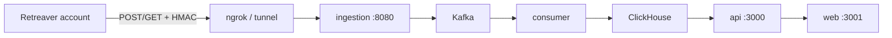

# Retreaver Ingestion Real Test (Local Docker + Tunnel)

## Context

The attached playbook is correct: **no new ingestion code is required**. Retreaver connector, HMAC auth, `call_key` encryption (Phase 0), `NormalizeState`, and Redis dedup are already implemented.

**Environment choice:** Local Docker stack + **tunnel** (ngrok / Cloudflare Tunnel) so Retreaver can POST to `https://<tunnel>/webhooks/retreaver/{token}`.



---

## STEP 0 — Pre-flight code confirmation

Run and capture raw output in the report.

| Check | Expected | Key files |
|-------|----------|-----------|
| Connector exists | `retreaver.go` | [`services/ingestion/internal/connectors/retreaver.go`](services/ingestion/internal/connectors/retreaver.go) |
| Auth | `Authenticate` → `VerifyRetreaverHMAC` | [`services/ingestion/internal/security/platform_hmac.go`](services/ingestion/internal/security/platform_hmac.go) |
| `call_key` parse | `firstValue(..., "call_key", ...)` + JSON fallback | `retreaver.go` L98, L102–117 |
| `call_key` encrypt | `producer.Publish` → `crypto.EncryptSecret` → hex | [`services/ingestion/internal/producer/producer.go`](services/ingestion/internal/producer/producer.go) |
| Route | `GET/POST /webhooks/` | [`services/ingestion/cmd/server/main.go`](services/ingestion/cmd/server/main.go) L60–61 |
| Dev integration row | `platform='retreaver'` | [`db/postgres/migrations/000018_multi_platform_integrations.up.sql`](db/postgres/migrations/000018_multi_platform_integrations.up.sql) |

**Postgres pre-flight** (adjust if container name differs):

```sql
SELECT platform, name, is_active, webhook_token
FROM integrations WHERE platform = 'retreaver';
```

**Note:** [`docs/real-readiness-report.md`](docs/real-readiness-report.md) §2.3 lists `call_key` as a blocker — **outdated**. Phase 0 fixed this; cite [`docs/ingestion-slice-report.md`](docs/ingestion-slice-report.md) instead.

---

## STEP 1 — Payload mapping audit (flag mismatches before real traffic)

Document Retreaver expected fields vs our parser in the report.

### What Calyx accepts today

| Internal field | Query / tag sources | Normalization |
|----------------|---------------------|---------------|
| `external_call_id` | `call_uuid`, `callUuid`, `CallUUID` | required |
| `call_key` | `call_key`, `callKey`, `CallKey` (query or JSON) | encrypted at publish; logged as `call_key_present` only |
| `state` | `state`, `State`, `tag[state]`, `tags` CSV, `tag[geo_state]` | `NormalizeState()` in [`ping_builder.go`](services/ingestion/internal/connectors/ping_builder.go) |
| `caller` | `caller`, `caller_id`, `caller_number`, `ani` | ANI hashed/encrypted |
| `revenue` | `revenue`, `conversion_value`, `payout`, `tags[revenue]` | float |
| `event` | `event`, `event_type`, `status` | defaults `incoming` |

### Auth (must match Retreaver account)

Our implementation ([`platform_hmac.go`](services/ingestion/internal/security/platform_hmac.go)):

- Header: `X-Retreaver-Signature` (fallback `X-Signature`)
- Algorithm: **HMAC-SHA256**, hex-encoded
- Signed material: **raw query string** (GET) or **request body** (POST)

**Pre-test gate:** Compare against Retreaver's actual postback signing docs for the customer's account. If Retreaver uses a different header, algorithm, or signing payload, ingestion will return **401** — fix connector only if mismatch is confirmed.

### Known risk — JSON POST path

When `Content-Type: application/json`, Retreaver uses [`ParseRingbaJSON`](services/ingestion/internal/connectors/ringba.go) (Ringba field names: `CallID`, `caller_id`, etc.). Real Retreaver JSON field names may differ.

**Recommendation for first real test:** Configure Retreaver postback as **GET query string** (same shape as [`scripts/smoke-test.ps1`](scripts/smoke-test.ps1) Retreaver branch) to avoid JSON field mismatch. Document JSON gap; code fix only if Retreaver cannot send query params.

### Retreaver postback template (query GET)

```
https://<TUNNEL_HOST>/webhooks/retreaver/<REAL_TOKEN>?call_uuid=[uuid]&call_key=[key]&caller=[caller]&state=[state]&event=incoming&revenue=[revenue]
```

Sign with `go run ./cmd/platformsig retreaver "<raw-query-without-leading-?>"` using the **same secret** stored in `integrations.webhook_secret`.

---

## STEP 2 — Local stack + credentials

1. **Stack running:** `make dev-up` or `docker compose up -d` in [`deploy/`](deploy/)
2. **MOCK_MODE (Option B):** Keep `MOCK_MODE=true` on scoring/compliance/attribution — ingestion is never mock-gated ([`docs/ingestion-slice-report.md`](docs/ingestion-slice-report.md))
3. **Tunnel:** Expose ingestion `:8080` (e.g. `ngrok http 8080`); note HTTPS URL
4. **Real credentials in Postgres** (not code) — replace dev placeholders for tenant `11111111-1111-1111-1111-111111111111`:

```sql
UPDATE integrations
SET webhook_token = '<REAL_TOKEN>',
    webhook_secret = '<REAL_RETREAVER_SIGNING_SECRET>',
    is_active = true,
    updated_at = NOW()
WHERE tenant_id = '11111111-1111-1111-1111-111111111111'
  AND platform = 'retreaver';
```

5. Rebuild ingestion if not current: `docker compose up -d --build ingestion`

**User must provide:** real Retreaver signing secret + chosen webhook token (can keep dev token if Retreaver URL uses it).

---

## STEP 3 — Point Retreaver at Calyx

In Retreaver account: set postback URL to tunnel + `/webhooks/retreaver/{token}`.

- Include: `call_uuid`, `call_key`, `state` (or tag macro), `revenue`, `caller`
- Ensure signing matches `VerifyRetreaverHMAC` (see STEP 1)
- Use **2–3 states** including a non-demo state (e.g. **WA**)

---

## STEP 4 — Fire real test calls

Generate a handful of real Retreaver calls. Ensure at least one includes `call_key` so Phase 0 encryption is exercised on real data.

---

## STEP 5 — End-to-end verification

Add [`scripts/verify-retreaver-real.ps1`](scripts/verify-retreaver-real.ps1) (new) modeled on [`scripts/verify-ingestion-slice.ps1`](scripts/verify-ingestion-slice.ps1):

1. Login → `GET /pings?platform=retreaver&limit=10`
2. `GET /analytics/platform-mix` — Retreaver present
3. `GET /coverage/heatmap` — states from real calls (refresh `/coverage` page manually — not live per [`docs/coverage-data-faq.md`](docs/coverage-data-faq.md))
4. ClickHouse checks (no `call_key` values printed):

```sql
-- States from real Retreaver rows
SELECT state, count() FROM pings
WHERE platform = 'retreaver' AND is_duplicate = 0
GROUP BY state ORDER BY count() DESC;

-- call_key presence + ciphertext length (not value)
SELECT countIf(call_key != '') AS with_key,
       countIf(length(call_key) > 30) AS likely_ciphertext
FROM pings WHERE platform = 'retreaver';
```

5. Ingestion logs: `docker logs deploy-ingestion-1 --tail 40` — expect `ping ingested`, `call_key_present=true`, no 401

**Checkbox list** (from playbook):

- [ ] Ingestion 200 (real HMAC, not 401)
- [ ] ClickHouse rows with normalized state
- [ ] Non-demo state (e.g. WA) present
- [ ] `call_key` encrypted (length > 30, not plaintext); absent from API/UI/logs
- [ ] Dashboard `/pings` shows Retreaver; platform-mix includes Retreaver
- [ ] Coverage map shows states after page refresh
- [ ] Duplicate resend does not inflate analytics/coverage totals

---

## STEP 6 — Deliverable report

Create **[`docs/retreaver-real-test-report.md`](docs/retreaver-real-test-report.md)** with:

1. Pre-flight grep/SQL output
2. Payload mapping table + any mismatch found
3. Tunnel URL + credential update method (never print secrets or `call_key` values)
4. Raw verification command output
5. PASS/FAIL checklist
6. What this proves / next steps (Phases 1–2: Deepgram + OpenAI on real calls)

Optional: `make verify-retreaver-real` target in [`Makefile`](Makefile).

---

## Out of scope (this milestone)

- Deepgram transcription / OpenAI scoring on real calls
- Coverage live polling / WebSocket refresh
- Code changes unless STEP 1 finds auth or field-name mismatch with real Retreaver traffic
