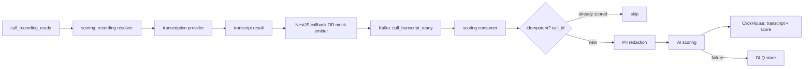
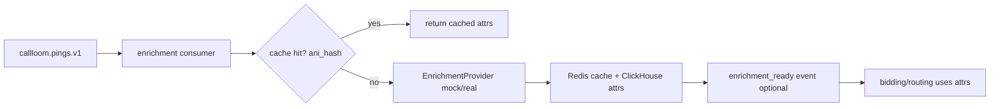

## Assumptions / constraints (based on current repo)
- Existing Kafka topics only include `callloom.pings.v1` (see `[deploy/docker-compose.yml](deploy/docker-compose.yml)` `kafka-init`).
- `services/ingestion` publishes normalized pings to Kafka using `tenant_id` as the Kafka key and a JSON envelope (see `[services/ingestion/internal/producer/producer.go](services/ingestion/internal/producer/producer.go)`).
- `services/consumer` consumes pings and writes to ClickHouse; there is no current scoring/enrichment service.
- `services/api` is NestJS with modules for `auth`, `health`, `pings`, `integrations` and ClickHouse reads via `[services/api/src/database/clickhouse.service.ts](services/api/src/database/clickhouse.service.ts)`.
- We will implement the chosen callback path: `callback endpoint` publishes an event to Kafka; `scoring service` consumes it.

## Locked decisions (user-confirmed)

### 1. Idempotency — one score per call, no re-scoring
- **Rule:** Ek call sirf ek baar score hogi. `call_id` idempotency key kaafi hai.
- **Redis key:** `{tenant_id}:scoring:scored:{call_id}` (SET on first successful score; TTL optional for cleanup only).
- **Behavior:** Agar key exists → skip silently (log at info), offset commit karo, koi duplicate score write nahi.
- **Out of scope (Phase 2):** Re-scoring, score versioning, admin "re-score" action. Baad mein add hoga agar zaroorat ho.

### 2. DLQ — store for manual replay, admin endpoint later
- **Rule:** Failed events kabhi drop nahi — DLQ table/topic mein persist karo.
- **Phase 2 scope:** DLQ storage + structured failure metadata (`tenant_id`, `call_id`, `event_type`, `error`, `payload_hash`, `failed_at`).
- **Out of scope (Phase 2):** Admin replay endpoint, automated DLQ consumer, replay UI. Yeh Phase 2.5 / Phase 3 mein aayega.
- **Operator workflow (now):** Manual SQL/query ya script se DLQ rows inspect + replay (documented runbook).

### 3. Enrichment trigger — on ping, before bidding (NOT on call_scored)
- **Rule:** Enrichment `callloom.pings.v1` pe trigger hoti hai, bidding decision se pehle.
- **NOT triggered by:** `call_scored`, `call_recording_ready`, ya koi post-call event.
- **Rationale:** Bidding/routing ko enriched attributes chahiye jab ping aati hai; post-call scoring alag pipeline hai.
- **Dedup:** `{tenant_id}:enrichment:ani_hash:{ani_hash}` — same number cache se serve, provider call skip.

## Target v2 outcomes (build-without-real-data ready)
- `MOCK_MODE=true` runs the entire scoring path end-to-end with realistic fake transcripts/scores.
- `MOCK_MODE=false` later swaps provider implementations (Deepgram/OpenAI) via config, without changing pipeline code.
- Every external touchpoint uses an interface + registry (mock + real implementations).

## Mock/Real switch contract (locked)

All Phase 2 services that call external APIs must follow this contract. Switching mock ↔ real is **config-only** — no code changes, no redeploy of business logic beyond service restart.

### Global flag
| Env | Default | Scope |
|-----|---------|-------|
| `MOCK_MODE` | `true` (local dev + docker-compose) | All Phase 2 services: `scoring`, `enrichment`, `api` (analytics/alerts/platforms modules) |

- `MOCK_MODE=true` → registry resolves mock implementations for every provider unless explicitly overridden to `mock` anyway.
- `MOCK_MODE=false` → registry resolves real implementations per `*_PROVIDER` env; **missing required secrets = boot fail** (see validation matrix below).

### Per-provider overrides (`*_PROVIDER` env)
Registry checks `*_PROVIDER` first; if unset, derives from `MOCK_MODE` (`mock` when true, configured default when false).

| Env var | Service | Values | Mock impl | Real impl |
|---------|---------|--------|-----------|-----------|
| `TRANSCRIPTION_PROVIDER` | scoring | `mock`, `deepgram` | `mock.go` | `deepgram.go` |
| `AI_PROVIDER` | scoring | `mock`, `openai` | `ai_mock.go` | `ai_openai.go` |
| `RECORDING_SOURCE` | scoring | `mock`, `native`, `ringba`, `retreaver`, `trackdrive`, `callgrid` | `source_mock.go` | `source_*.go` |
| `ENRICHMENT_PROVIDER` | enrichment | `mock`, `enrollhere`, `whitepages` | `mock.go` | `enrollhere.go`, `whitepages.go` |
| `ADSPEND_SOURCE` | api (analytics) | `mock`, `manual`, `google`, `meta` | `adspend.mock.ts` | `adspend.*.ts` |
| `NOTIFICATION_CHANNEL` | api (alerts) | `mock`, `email`, `sms`, `slack`, `inapp` | `mock.channel.ts` | `*.channel.ts` |
| `PLATFORM_CONNECTOR` | api (platforms) | `mock`, `ringba`, `retreaver`, `trackdrive`, `callgrid`, `callloom-native` | `mock.connector.ts` | `*.connector.ts` |

### Required secrets when `MOCK_MODE=false`

| Provider | Required env vars | Boot fails if missing |
|----------|-------------------|----------------------|
| `deepgram` | `DEEPGRAM_API_KEY`, `DEEPGRAM_CALLBACK_SECRET` | Yes |
| `openai` | `OPENAI_API_KEY` | Yes |
| `enrollhere` | `ENROLLHERE_API_KEY` | Yes |
| `whitepages` | `WHITEPAGES_API_KEY` | Yes (when selected as provider) |
| `ringba` / other recording sources | Per-tenant creds in `platform_credentials` table OR env fallback for dev | Yes if resolver cannot load creds |
| `google` / `meta` ad spend | respective API keys (Phase 3) | Yes when selected |
| `email` / `sms` / `slack` alerts | channel-specific secrets | Yes when selected |

### Boot-time validation matrix

```
On service startup (scoring, enrichment, api):
  1. Parse MOCK_MODE (default true if unset in dev)
  2. Parse each *_PROVIDER env (or derive from MOCK_MODE)
  3. For each resolved real provider:
       - assert required env vars / DB creds present
       - if any missing → log structured error + os.Exit(1) / process.exit(1)
  4. Log resolved provider map at info level:
       { "mock_mode": false, "transcription": "deepgram", "ai": "openai", ... }
  5. NEVER silently fall back to mock when MOCK_MODE=false
```

**Hard rule:** `MOCK_MODE=false` + missing `DEEPGRAM_API_KEY` → service **must not start**. No degraded/mock fallback in production path.

### Switching procedures

**Mock → Real (go live on one provider):**
1. Set `MOCK_MODE=false` in `.env` (or per-service override in docker-compose).
2. Set `*_PROVIDER` to real name (e.g. `TRANSCRIPTION_PROVIDER=deepgram`).
3. Add real API keys to `.env` (never commit).
4. Rebuild/restart affected services only.
5. Verify `/readyz` passes and startup logs show real provider map.

**Real → Mock (rollback / local dev):**
1. Set `MOCK_MODE=true`.
2. Optionally set all `*_PROVIDER=mock` explicitly.
3. Remove or leave API keys empty — mock path ignores them.
4. Restart services.

### Files to update (Chunk 1)
- `[.env.example](.env.example)` — add `MOCK_MODE=true` + all `*_PROVIDER` vars with comments.
- `[deploy/docker-compose.yml](deploy/docker-compose.yml)` — pass `MOCK_MODE` and provider vars to `scoring`, `enrichment`, `api`.
- Each service `config.go` / `env.ts` — parse, validate, fail fast.

## Core event flows (chosen)

### Scoring path (post-call)


### Enrichment path (on ping, pre-bidding)


## Small feature chunks (recommended execution order)

### Chunk 1: Shared contracts + Kafka topics/DLQ (foundation)
1. Add `[shared/contracts]` folder with JSON event schema artifacts (or a minimal “single source of truth” to start), e.g.
   - `shared/contracts/events/ping_event.schema.json`
   - `shared/contracts/events/call_recording_ready.schema.json`
   - `shared/contracts/events/call_transcript_ready.schema.json`
   - `shared/contracts/events/call_scored.schema.json`
2. Add a runtime event validator layer in Go and NestJS (keep it strict):
   - Reject unknown/malformed events before processing.
   - Require `tenant_id`, `event_id`, `schema_version`, and `call_id`.
3. Add Kafka topic creation in local docker compose init:
   - Extend `[deploy/docker-compose.yml](deploy/docker-compose.yml)` `kafka-init` to create:
     - `callloom.calls.call_recording_ready.v1`
     - `callloom.calls.call_transcript_ready.v1`
     - `callloom.calls.call_scored.v1`
     - DLQ topics (e.g. `callloom.scoring.dlq.v1`, `callloom.enrichment.dlq.v1`) for failure persistence.
4. Add ClickHouse DLQ tables (`scoring_dlq`, `enrichment_dlq`) per spec — primary store for manual replay inspection.
5. Add `scripts/init-kafka-topic.sh` parity (if used) for the new topics.
6. **No admin replay endpoint in Phase 2** — DLQ is write-only from services; replay is manual later.
7. **Mock/Real switch contract:** implement `MOCK_MODE` (default `true`), `*_PROVIDER` registry wiring, boot-time validation matrix in shared config pattern; update `.env.example` + docker-compose.

**Done criteria:** scoring + enrichment topics exist in local; DLQ rows persist on failure; mock producer can publish/validate events; services log resolved provider map on startup.

### Chunk 2: Scoring service skeleton (Go, mock-first)
Create a new service folder: `[services/scoring]` with structure close to the spec.
1. Implement `/healthz` and `/readyz`.
2. Config-driven provider registries (interfaces + mock implementations):
   - `RecordingSource` (mock for now)
   - `TranscriptionProvider` (mock provider)
   - `AIProvider` (deterministic mock scorecard evaluation)
3. Implement Kafka consumer(s):
   - Consumer for `call_transcript_ready.v1` as the “scoring input”.
4. Implement core pipeline pieces:
   - **Idempotency (locked):** Redis key `{tenant_id}:scoring:scored:{call_id}` — if exists, skip (no re-scoring in Phase 2)
   - Budget guard stubs (mock_mode => allow, real_mode => enforce)
   - PII redaction before transcript storage/logging
   - **DLQ (locked):** on any unrecoverable failure, write to `scoring_dlq` ClickHouse table + optional DLQ Kafka topic; no auto-replay
5. Implement ClickHouse repositories and write path for:
   - transcripts table (mock transcript + utterances)
   - call scores table

**Done criteria:** when you publish a `call_transcript_ready` mock event, scoring stores rows in ClickHouse.

### Chunk 3: Callback endpoint -> Kafka publish (NestJS)
Since the chosen architecture is callback->Kafka:
1. Add module + controller:
   - `services/api/src/scoring/deepgram-callback.controller.ts`
2. Endpoint responsibilities:
   - Verify callback secret (env-based)
   - Validate payload with zod schema
   - Extract `tenant_id`, `call_id`, and transcript (or transcript reference)
   - Publish Kafka event `call_transcript_ready.v1`
3. Add Kafka producer abstraction in NestJS (config-driven topic + broker).

**Done criteria:** callback endpoint can accept a mocked payload and publish `call_transcript_ready` into Kafka.

### Chunk 4: End-to-end mock runner (make “build without real data” true)
Because Phase 1 currently only emits pings:
1. In `MOCK_MODE=true`, ensure that `call_transcript_ready` events are created without real platforms.
2. Two acceptable production patterns (pick one during implementation):
   - Option A (preferred): a small mock emitter inside `services/scoring` that consumes pings (`callloom.pings.v1`) and generates `call_recording_ready` + `call_transcript_ready`.
   - Option B: a dedicated `services/platform-mock` that emits the full chain.
3. Emit realistic transcript text + deterministic scoring outputs.

**Done criteria:** starting docker compose, web dashboard can hit scoring-related endpoints (or at least ClickHouse has transcript+scores), with zero external API keys.

### Chunk 5: NestJS scoring APIs (reads)
1. Add endpoints for UI consumption:
   - `GET /scoring/scores?callId=...`
   - `GET /scoring/transcript?callId=...`
   - optionally `GET /scoring/list` with pagination
2. Enforce tenant scoping using the existing `[CurrentTenant]` decorator and ClickHouse queries.

**Done criteria:** web can display a call’s transcript & score using Phase-2 data.

### Chunk 6: Enrichment skeleton (Go, mock-first) + API proxy
1. New `services/enrichment` consuming **`callloom.pings.v1`** (same topic as Phase 1 consumer, separate consumer group).
2. **Trigger rule (locked):** enrich on every non-duplicate ping, before bidding — NOT on `call_scored`.
3. Interfaces + mock providers for `EnrichmentProvider`.
4. Redis cache TTL + dedup by `ani_hash` (never call provider twice for same number within TTL).
5. ClickHouse `enrichment_attrs` table writes.
6. Optional: publish `enrichment_ready.v1` for downstream bidding modules.
7. NestJS enrichment endpoints as thin proxies (`GET /enrichment/:ani_hash` read from cache/ClickHouse).
8. DLQ on enrichment failure → `enrichment_dlq` table (manual replay later).

**Done criteria:** jab ping aati hai (`callloom.pings.v1`), enrichment 500+ mock attributes likhti hai; `call_scored` event enrichment trigger nahi karti.

### Chunk 7: Coverage + Analytics modules (NestJS)
1. Coverage heatmap endpoints via ClickHouse.
2. Analytics metrics endpoints with mock ad spend via `AdSpendSource` interface.

**Done criteria:** endpoints return stable JSON results in MOCK_MODE.

### Chunk 8: Alerts engine (NestJS)
1. Add alert-rule CRUD in Postgres.
2. Implement Kafka consumer inside `alerts` for real-time evaluation.
3. Plug notification channels (mock logs channel first).

**Done criteria:** publishing `call_scored` events triggers alert evaluations and a mock notification record.

## Cross-cutting “production ready” requirements to bake into every chunk
- **Scoring idempotency:** `call_id` key only; one score per call; no re-scoring in Phase 2.
- **Enrichment idempotency:** `ani_hash` cache key; skip provider call on cache hit.
- **DLQ:** persist all failures to ClickHouse DLQ tables; manual replay only (admin endpoint deferred).
- Graceful shutdown: stop Kafka consumption, finish in-flight, close DB connections.
- Structured logs with `trace_id` and `tenant_id`.
- Circuit breaker wrappers around external calls (real mode) and no-crash behavior on timeouts.
- Strong input validation at entry points.
- **Mock/Real switch:** `MOCK_MODE` default true; per-provider `*_PROVIDER` overrides; boot fail if real mode secrets missing; no silent mock fallback.

## Deliverables checklist
- [ ] New services: `services/scoring` and (later) `services/enrichment`
- [ ] Kafka: new topics + DLQs + runtime validation
- [ ] NestJS: scoring callback controller + scoring read APIs
- [ ] ClickHouse: transcripts + scores + enrichment attrs migrations
- [ ] Postgres: scorecards/alert rules migrations (as spec)
- [ ] MOCK_MODE end-to-end path (no external keys required)
- [ ] Scoring: call_id idempotency enforced (no re-scoring)
- [ ] DLQ tables populated on failure (no admin replay endpoint yet)
- [ ] Enrichment: triggered on ping only, before bidding
- [ ] Mock/Real switch contract: `MOCK_MODE` + `*_PROVIDER` + boot validation in `.env.example` and docker-compose
