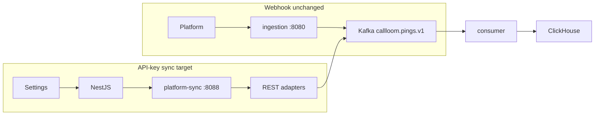

# Calyx — All-Platform REST Adapters (API-key sync)

**Status:** Implemented (mock verify: `make verify-api-sync`; real: per-platform scripts + `MOCK_MODE=false`)  
**Per-platform reports (after build):** `docs/apisync-{platform}-report.md`

---

## Goal

Make API-key sync **real** for all webhook platforms — **Ringba, Retreaver, TrackDrive, CallGrid** — so pasting credentials pulls real calls into the **same Kafka → ClickHouse → dashboard/coverage** path as webhooks.

**Today:** API-key mode is mock-only (`apisync-{platform}-*` demo calls).  
**Approach:** Research all platforms together; build adapters **one at a time**; verify each before the next.

**Call Loom is NOT in this set** — native direct source (`/sources/callloom-native/v1/pings`), no REST pull adapter.

---

## Current codebase (starting point)

| Area | Path | State |
|------|------|-------|
| Sync worker | `services/platform-sync/` | Mock adapter only; real mode errors |
| Webhook field maps | `services/ingestion/internal/connectors/` | Production-shaped for all 4 platforms |
| API integrations | `services/api/src/integrations/` | create/test/sync; test does not probe real API |
| DB sync state | `db/postgres/migrations/000019_*` | `sync_cursor`, `last_sync_at` only |
| Verify (mock) | `scripts/verify-api-sync.ps1` | Passes with MOCK_MODE |



---

## STEP 0 — Research table (all platforms; verify against official docs)

**Deliver:** `docs/apisync-platform-research.md` (field-level detail) — this plan is the summary.

| Platform | Pull API? | Endpoint | Auth | Incremental | Pagination | Rate limits | `call_key` in API? |
|----------|-----------|----------|------|-------------|------------|-------------|-------------------|
| **Retreaver** | Yes | `GET https://api.retreaver.com/api/v2/calls.json` | Query: `api_key` + `company_id` | `created_at_start` (RFC3339); `sort_by=created_at` | `page`, `per_page` | Not documented — conservative backoff | **No** — webhook-only for conversion postbacks |
| **Ringba** | Yes | `POST https://api.ringba.com/{accountId}/CallLogs/Date` | Header: `Authorization: {API_ACCESS_TOKEN}` (Bearer deprecated Jun 2025) + path `accountId` | Body: `reportStart` / `reportEnd`; cursor via `offset` | `size` + `offset` on `callLog.data[]` | 5/sec, 80/min call logs; export stricter | N/A |
| **TrackDrive** | Yes | `GET https://{subdomain}.trackdrive.com/api/v1/calls` | `Authorization: Basic base64(public:private)` or developer `auth_token` | `created_at_from` / `created_at_to` | `page` + `cursor` (start `-1`, `metadata.next_cursor`; `per_page` > 10 needs cursor) | Not documented — backoff on errors | N/A |
| **CallGrid** | Yes | `GET https://api.callgrid.com/api/call` | `Authorization: Bearer {API_KEY}` or `?apiKey=` | `startDate` / `endDate` (ISO) | `useCursor=true`, `maxItems`, `searchAfter` | 80 req/min; 429 + `RateLimit-*` headers | N/A |
| **Call Loom** | **Out of scope** | Direct `/sources/callloom-native/v1/pings` | Internal | — | — | — | — |

**Sources:** [Retreaver Core API](https://retreaver.github.io/core-api-docs/), [Ringba API / PHP SDK](https://github.com/diablomedia/ringba-php-sdk), [TrackDrive API 1.0](https://trackdrive.com/api/docs/1.0/calls/index.html), [CallGrid API](https://callgrid.com/api).

### Field mapping targets (mirror webhook connectors)

Reference: `services/ingestion/internal/connectors/{ringba,retreaver,trackdrive,callgrid}.go`

| Internal | Retreaver v2 | Ringba | TrackDrive | CallGrid |
|----------|-------------|--------|------------|----------|
| `external_call_id` | `uuid` | `inboundCallId` / column id | `uuid` | id from `data[]` (confirm live) |
| caller → hash/encrypt | `caller` | Tags: caller number | `caller_number` | inbound number tag |
| `state` | `caller_state` | Tags: state/region | geo fields / tokens | state tag |
| `revenue` | `revenue` | columns/tags | `revenue` / `buyer_revenue` | revenue field |
| `payout` | `payout` | payout tag | `traffic_source_payout` | payout field |
| `campaign_id` | `campaign_id` | Tags campaign | `offer_id` | campaign tag |
| `publisher_id` | `client_afid` | Tags publisher | `traffic_source_id` | affiliate id |
| `target_id` | `target_id` | Tags target | `buyer_id` | buyer/target id |
| `event_type` | derive from `status` | derive from events | `status` / `buyer_converted` | call status |
| `call_key` | — | — | — | — |

Ringba: response nests `Columns`, `Events`, `Tags` per call — use a lookup helper, not inline parsing.

---

## SHARED FRAMEWORK (build once before first real adapter)

### Adapter interface

Replace monolithic `Registry.Fetch` in `services/platform-sync/internal/adapter/adapter.go`:

```go
type PlatformAdapter interface {
    Platform() string
    TestAuth(ctx context.Context, creds map[string]string) error
    FetchPage(ctx context.Context, creds map[string]string, cursor string) (PageResult, error)
}
type PageResult struct {
    Calls      []models.RemoteCall
    NextCursor string // opaque JSON per platform
}
```

**New / updated packages:**

| File | Purpose |
|------|---------|
| `adapter/mock.go` | Existing mock unchanged |
| `adapter/httpclient.go` | Timeouts, 429 backoff, `sony/gobreaker` |
| `adapter/cursor.go` | Encode/decode per-platform cursor JSON |
| `adapter/{platform}/` | One package per platform |

**Shared downstream (no per-platform reinvention):**

- `NormalizeState()` — same as webhook (`internal/state`)
- ANI hash + `call_key` encrypt — same crypto as ingestion
- Kafka topic `callloom.pings.v1`
- Redis dedup `{tenant_id}:dedup:{platform}:{external_call_id}`
- `sync_cursor` persistence (migration 000019)

**Extend `RemoteCall`** in `models/models.go`: add `CampaignID`, `PublisherID`, `TargetID` for full `PingMessage` in producer.

### Credentials + Settings (dynamic form per platform)

Encrypted JSON in `api_credentials_blob`:

| Platform | Fields |
|----------|--------|
| Retreaver | `api_key`, `company_id` |
| Ringba | `api_token`, `account_id` |
| TrackDrive | `subdomain`, `public_key`, `private_key` (or `auth_token`) |
| CallGrid | `api_key` |

Update: `integrations.service.ts`, `AddIntegrationForm.tsx`, `api.ts` Zod validation.

### Migration 000020 — sync error visibility

Add to `integrations`:

- `last_sync_error TEXT`
- `sync_status TEXT` — `idle` | `syncing` | `ok` | `error`

Extend `update_integration_sync_state()`; expose in API list + Settings UI.

### Real test connection

- `platform-sync`: `POST /test-auth` → adapter `TestAuth`
- `integrations.service.ts`: when `MOCK_MODE=false`, call test endpoint; clear ok/error (never log keys)

### Syncer rules (`syncer.syncOne`)

- Success: publish → dedup → advance cursor → `sync_status=ok`
- Empty page: no-op; cursor policy per platform
- Auth/4xx: `sync_status=error`, **do not** advance cursor
- 429: backoff within timeout

**MOCK_MODE:** `true` → mock only; `false` → real adapter, **fail-fast** (no silent mock fallback).

---

## STEP 1 — Build adapters ONE AT A TIME

### Order

1. **Retreaver** (existing webhook + real-test tooling)
2. **Ringba**
3. **TrackDrive**
4. **CallGrid** (pull API confirmed — build if Step 0 still valid)

### Per-slice checklist

- [ ] API researched + documented — matches real docs
- [ ] Adapter implements shared interface; selected when `MOCK_MODE=false`
- [ ] Test connection validates real key (ok vs clear error)
- [ ] First sync → Kafka → ClickHouse; dashboard/coverage show platform
- [ ] `state` normalized; ANI encrypted; `call_key` only if API provides (Retreaver: no)
- [ ] Cursor advances; re-sync no duplicates (cursor + Redis dedup)
- [ ] `MOCK_MODE=true` mock unchanged
- [ ] Errors/limits handled; keys never logged
- [ ] `go test` / build / verify scripts green
- [ ] Report: `docs/apisync-{platform}-report.md` with raw output

### Slice 1 — Retreaver

- `internal/adapter/retreaver/` + fixture tests from official JSON samples
- Cursor: `{ "created_at_start", "page" }` — init from `sync_cursor` or `last_sync_at - 5min`
- `TestAuth`: `GET .../calls.json?per_page=1`
- Script: `scripts/verify-apisync-retreaver-real.ps1`
- Report: `docs/apisync-retreaver-report.md`

### Slice 2 — Ringba

- `POST /{accountId}/CallLogs/Date`; parse `callLog.data[]`
- Cursor: `{ reportStart, reportEnd, offset }`
- Rate limit: ≥200ms between requests (5/sec)
- Report: `docs/apisync-ringba-report.md`

### Slice 3 — TrackDrive

- Subdomain base URL; Basic auth
- Cursor: `{ created_at_from, cursor }` per TrackDrive cursoring docs
- Report: `docs/apisync-trackdrive-report.md`

### Slice 4 — CallGrid

- Cursor pagination per CallGrid docs; 500ms between pages
- Honor `RateLimit-*` headers on 429
- Report: `docs/apisync-callgrid-report.md`

---

## STEP 2 — Errors, limits, safety (all adapters)

- Auth failure → `sync_status=error`, message in Settings; worker continues
- Rate limits → per-platform backoff on 429
- Empty/no new → no-op; cursor unadvanced on failure
- Never log API keys, `call_key`, or ANI

---

## STEP 3 — Mode behavior

| `MOCK_MODE` | Behavior |
|-------------|----------|
| `true` | Mock `apisync-{platform}-*` unchanged |
| `false` | Real HTTP for implemented platforms |

Real testing: set `MOCK_MODE=false` on **both** `api` and `platform-sync` in docker-compose.

---

## Verification commands

| Command | When |
|---------|------|
| `make verify-api-sync` | Mock path (CI/dev) |
| `make verify-apisync-retreaver-real` | After Retreaver adapter |
| (per-platform scripts) | After each subsequent adapter |

---

## Out of scope

- Call Loom REST adapter
- Webhook path changes
- CallGrid Bid API (RTB) — separate from call list sync

---

## One-line

Research all Calls APIs together, shared sync interface, then real REST adapters one platform at a time (Retreaver → Ringba → TrackDrive → CallGrid), same normalize/encrypt/dedup/Kafka as webhook; Call Loom stays direct.
