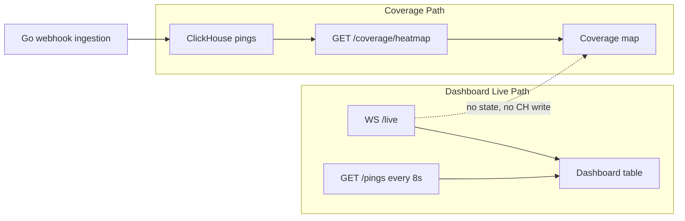

# Coverage Live Data & Mock Mode — Verified FAQ

**Date:** 2026-07-06  
**Status:** Code-verified answers (no implementation changes in this doc)

---

## Urdu / English summary (user-facing)

### Q1: Kya coverage page par live data aata hai jaise ping feed par?

**Jawab: Nahi — abhi coverage page live nahi hai.**

Dashboard ping feed WebSocket + har 8 second HTTP poll use karti hai. Coverage page sirf **page load par ek baar** `GET /coverage/heatmap` call karti hai. Naya ping aane ke baad map tab tak update nahi hota jab tak aap page refresh na karein (`F5` / hard refresh).

### Q2: API mein 10 states / 126 pings sirf mock mode hai? Real integrations par saari states?

**Jawab: Nahi — yeh hardcoded cap nahi hai.**

10 states aur ~126 pings **demo tenant ke ClickHouse data ka snapshot** hai (fixtures + demo-seed + smoke tests). Coverage API **MOCK_MODE se independent** hai — hamesha ClickHouse se `GROUP BY state` query karti hai. Real Ringba/Retreaver webhooks jis state ke saath ingest honge, woh map par automatically dikhengi (`LIMIT 100`, koi fixed 10-state list nahi).

---

## Q1 — Is coverage page live like the ping feed?

**Verdict: No — coverage is not live today.**

### Comparison table

| Aspect | Dashboard ping feed | Coverage page (`/coverage`) |
|--------|---------------------|-------------------------------|
| Data hook | [`useHybridPingFeed`](../web/src/lib/use-hybrid-ping-feed.ts) | Single `useEffect` + [`fetchCoverageHeatmap`](../web/src/lib/api.ts) |
| WebSocket `/live` | Yes — [`useLiveFeed`](../web/src/lib/use-live-feed.ts) | **Not used** |
| HTTP polling | Yes — every **8s** via [`usePingFeed`](../web/src/lib/use-ping-feed.ts) (`pollMs = 8000`) | **None** |
| Refresh trigger | Auto (WS + poll) | **Page load only** — manual browser refresh required |
| Data source | WS mock events + `GET /pings` | `GET /coverage/heatmap` → ClickHouse aggregate |

### Evidence — coverage page fetch (load once)

```25:42:web/src/app/(app)/coverage/page.tsx
  useEffect(() => {
    const token = getToken();
    if (!token) return;

    fetchCoverageHeatmap(token)
      .then((res) => {
        setRows(res.data);
        setTotalPings(res.total_pings);
      })
      // ...
      .finally(() => setLoading(false));
  }, [router]);
```

Grep confirms no live hooks on coverage route:

```powershell
rg "useLiveFeed|pollMs|useHybridPingFeed" web/src/app/(app)/coverage
# (no matches)
```

### Why mock WebSocket does not update coverage

1. **WS `ping_received` payload has no `state` field** — [`pingEventPayloadSchema`](../services/api/src/live/live-event.types.ts) lists `platform`, `call_id`, `ani_hash`, etc., but not `state`.
2. **Mock emitter does not write to ClickHouse** — [`MockLiveEmitterService`](../services/api/src/live/mock-live-emitter.service.ts) pushes socket events only; coverage reads ClickHouse aggregates.
3. **Dashboard WS → ping row hardcodes empty state** — [`wsPingToRecord`](../web/src/lib/use-hybrid-ping-feed.ts) sets `state: ''`.

Real ingested pings (webhook → Kafka → consumer → ClickHouse) **do** appear in `/coverage/heatmap`, but only after the user **reloads** `/coverage`.

### Data flow diagram



---

## Q2 — Are 10 states / 126 pings mock-only? Will real integrations show all states?

**Verdict: Not a mock cap — it is whatever geo-tagged pings exist in ClickHouse for the tenant.**

### Coverage API query (MOCK_MODE-independent)

```19:33:services/api/src/coverage/coverage.service.ts
  async getHeatmap(tenantId: string): Promise<HeatmapResult> {
    const result = await this.clickhouse.getClient().query({
      query: `
        SELECT
          state,
          count() AS ping_count,
          sum(revenue) AS revenue
        FROM pings
        WHERE tenant_id = {tenant_id:UUID}
          AND state != ''
          AND is_duplicate = 0
        GROUP BY state
        ORDER BY ping_count DESC
        LIMIT 100
      `,
```

| Property | Value |
|----------|-------|
| Hardcoded 10-state list | **None** |
| Row limit | `LIMIT 100` (enough for 50 states + DC + territories) |
| Excluded rows | `state = ''` (no normalized geo) |
| Duplicates | `is_duplicate = 0` (Phase 0 aggregate filter) |
| MOCK_MODE gate | **None** — always ClickHouse |

### Where local dev “10 states” comes from

| Source | States |
|--------|--------|
| ClickHouse demo fixture [`db/clickhouse/migrations/000006_demo_fixture.up.sql`](../db/clickhouse/migrations/000006_demo_fixture.up.sql) | Primarily TX/CA/FL/NY rotation (~50 fixture rows) |
| [`scripts/demo-seed.ps1`](../scripts/demo-seed.ps1) | Explicitly **10 states**: TX, CA, FL, NY, AZ, GA, OH, NC, IL, PA |
| Signed webhooks / smoke tests | Any state sent in query (e.g. WA in `verify-ingestion-slice.ps1`) |

**MOCK_MODE=true** affects transcription, scoring, enrichment, ad platforms — **not** the coverage query path. See also [`docs/02-product-overview.md`](02-product-overview.md) and [`docs/10-known-gaps-and-roadmap.md`](10-known-gaps-and-roadmap.md).

### Real integration path (same UI/API with MOCK_MODE=false)

```
Ringba / Retreaver / TrackDrive / CallGrid webhook
  → Go ingestion NormalizeState() [services/ingestion/internal/state/state.go]
  → Kafka → consumer InsertPings [services/consumer/pkg/clickhouse/clickhouse.go]
  → GET /coverage/heatmap
  → Map colors + state labels (TX, CA, …)
```

### Map UI behavior

- **53 geographies** always render on the SVG map (labels via `d3-geo` `geoCentroid`).
- **Color/fill** only on states returned by the API.
- States with zero pings stay neutral (`#1a2535`).
- **Bar chart** shows **top 15** only — [`StateHeatmapChart.tsx`](../web/src/components/coverage/StateHeatmapChart.tsx) `data.slice(0, 15)`; map shows all API states.

---

## Gaps (explicit, actionable)

1. **No live refresh on `/coverage`** — unlike dashboard ping feed; user must refresh manually.
2. **WS events cannot drive coverage** — no `state` in live envelope; no incremental heatmap merge in UI.
3. **Pings without normalized state invisible on heatmap** — `WHERE state != ''`; bad/missing platform geo = missing state on map.
4. **Bar chart top 15 only** — map shows all returned states; chart is intentionally capped.
5. **Demo data ≠ all 50 states** — production shows only states with actual call volume (expected, not a bug).
6. **Empty API → no map** — page shows “No geographic data yet…” until first geo-tagged ping exists ([`coverage/page.tsx`](../web/src/app/(app)/coverage/page.tsx) lines 102–105).

---

## Cross-verification commands

### 1. Coverage heatmap API (auth)

```powershell
$login = Invoke-RestMethod -Uri "http://localhost:3000/auth/login" -Method POST `
  -ContentType "application/json" `
  -Body '{"email":"admin@calyx.ai","password":"calyx_dev"}'
$hm = Invoke-RestMethod -Uri "http://localhost:3000/coverage/heatmap" `
  -Headers @{ Authorization = "Bearer $($login.access_token)" }
Write-Host "states=$($hm.data.Count) total_pings=$($hm.total_pings)"
$hm.data | Format-Table state, ping_count, revenue
```

### 2. Confirm coverage page has no live feed hooks

```powershell
rg "useLiveFeed|pollMs|useHybridPingFeed" "web/src/app/(app)/coverage"
# Expected: no matches
```

### 3. Localhost browser check (map + labels + API)

```powershell
node scripts/check-coverage-localhost.mjs
```

**Last recorded PASS** (2026-07-03, local dev):

| Check | Value |
|-------|-------|
| Map SVG paths | 54 |
| State labels | 51 |
| API states with data | 10 |
| API total pings | 126 |
| TX / CA / NY labels | present |
| Geo pulse border | teal `rgba(0,201,183)` |

Counts drift as smoke tests and `verify-ingestion-slice` add pings — re-run commands above for current numbers.

---

## Related docs

- [`docs/coverage-map-report.md`](coverage-map-report.md) — map UI implementation and verification
- [`docs/ingestion-slice-report.md`](ingestion-slice-report.md) — Phase 0 real ingestion + dedup aggregates
- [`docs/real-readiness-report.md`](real-readiness-report.md) — full-platform MOCK_MODE=false readiness

---

## Future work (out of scope for this FAQ)

Adding coverage live refresh would be a **separate feature**: e.g. poll `GET /coverage/heatmap` every N seconds, or extend WS payload with `state` + client-side heatmap merge. Not implemented today.
