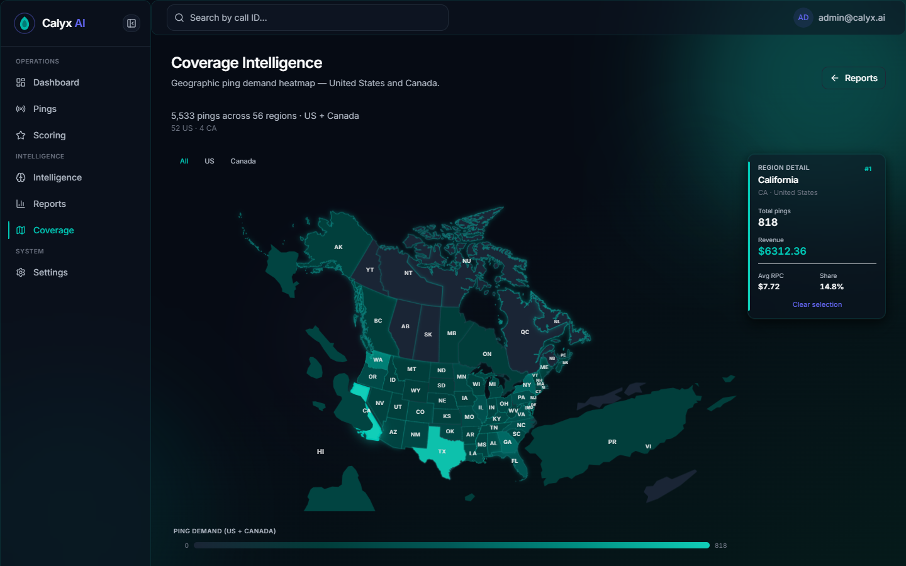

# Coverage UI — North America map (US + Canada)

**Date:** 2026-07-14  
**Design:** Extend existing graded-teal Coverage map (no redesign).  
**Logic companion:** [`docs/north-america-coverage-report.md`](north-america-coverage-report.md).  
**Screenshot:** [`docs/mockups/coverage-north-america.png`](mockups/coverage-north-america.png)

---

## Verdict

| Check | Result |
|-------|--------|
| US states + Canadian provinces, one shared color scale | **YES** |
| Projection shows both countries (`geoAlbers` + NA config; not `geoAlbersUsa`) | **YES** |
| `CA` = California / US; Canada = province codes only | **YES** (tooltip: `CA · United States`) |
| Ontario detail / country = Canada | **YES** |
| Header “US + Canada” + `52 US · 4 CA` (no “56 states”) | **YES** |
| Tooltip + detail include country | **YES** |
| All · US · Canada filter | **YES** |
| Mobile / a11y / reduced-motion floor preserved | **YES** (existing patterns) |
| `check-coverage-north-america.mjs` | **MAP_CHECK PASS** |

---

## What changed

### Geography

- Kept `web/public/geo/us-states-10m.json` (US FIPS → codes via `codeFromFips`).
- Added `web/public/geo/canada-provinces.geojson` (Click That Hood provinces) with stamped `properties.code` (`ON`, `BC`, …) and `country: CA`.
- Two `<Geographies>` layers in one `ComposableMap`, **shared** `d3-scale` teal gradient (`COLOR_DIM` → `COLOR_BRIGHT`).
- Projection: `geoAlbers` + `rotate: [96,0,0]`, `center: [-0.6, 52]`, `parallels: [29.5, 60]`, `scale: 520` so Canada is not clipped (unlike `geoAlbersUsa`).
- Empty regions stay dim (`COLOR_NEUTRAL`).

### Join key / CA collision

- US join: FIPS → postal code (`CA` = California).
- CA join: `properties.code` (province). Never a bare “Canada = CA”.
- Verified: California tooltip shows **United States**; Ontario panel shows **Canada**.

### Copy & chrome

- Page description: “United States and Canada.”
- Header: `{N} pings across {M} regions · US + Canada` + `{us} US · {ca} CA`.
- Tooltip: name + `code · country` + pings/revenue.
- Detail panel: “Region detail” + country line.
- Top-15 bars: `{CODE} · US|CA`.
- Legend: “Ping demand (US + Canada)”; max from combined filter set.
- Optional clean filter: **All · US · Canada**.

### SSR

- Still `next/dynamic` `ssr: false` via `CoverageMapDynamic`.
- Geo files fetched from `/geo/…` (public).

---

## Screenshot

Shows continental US + Canada provinces, TX selected, header split `52 US · 4 CA`, shared ping-demand scale.

---

## Verify checklist

- [x] Map renders US + Canada, shared scale  
- [x] ON → Ontario / Canada; CA → California / US  
- [x] AK / HI / PR / provinces present (labels / paths)  
- [x] Honest US + Canada header + split  
- [x] Tooltip + detail country  
- [x] Numbers = Coverage analytics (distinct known-region calls)  
- [x] Presentation 20/20; web build green  

Script: `node scripts/check-coverage-north-america.mjs`

---

## One-line

Graded-teal Coverage map extended to North America (Canada provinces on one scale, Albers NA projection, country in tooltip/detail, honest US+Canada header) with California≠Canada join fixed.
