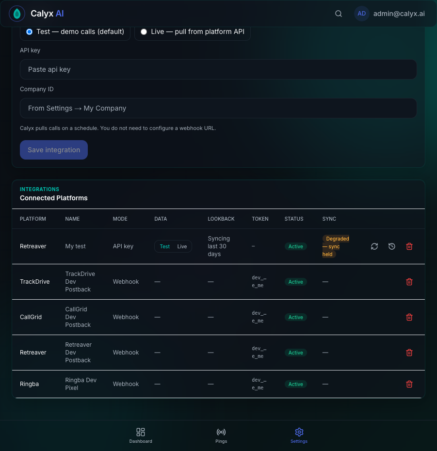
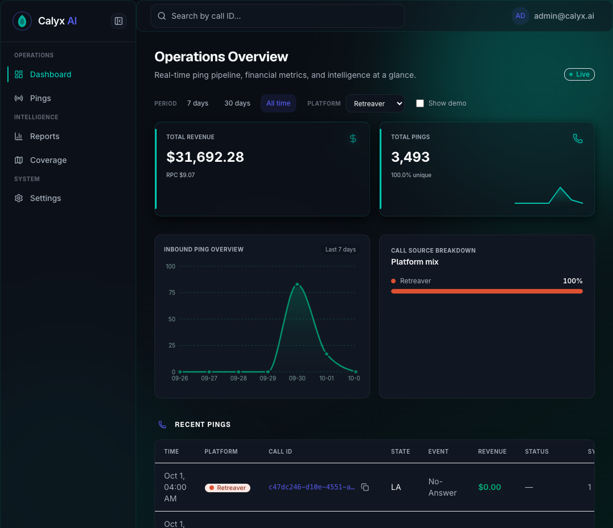
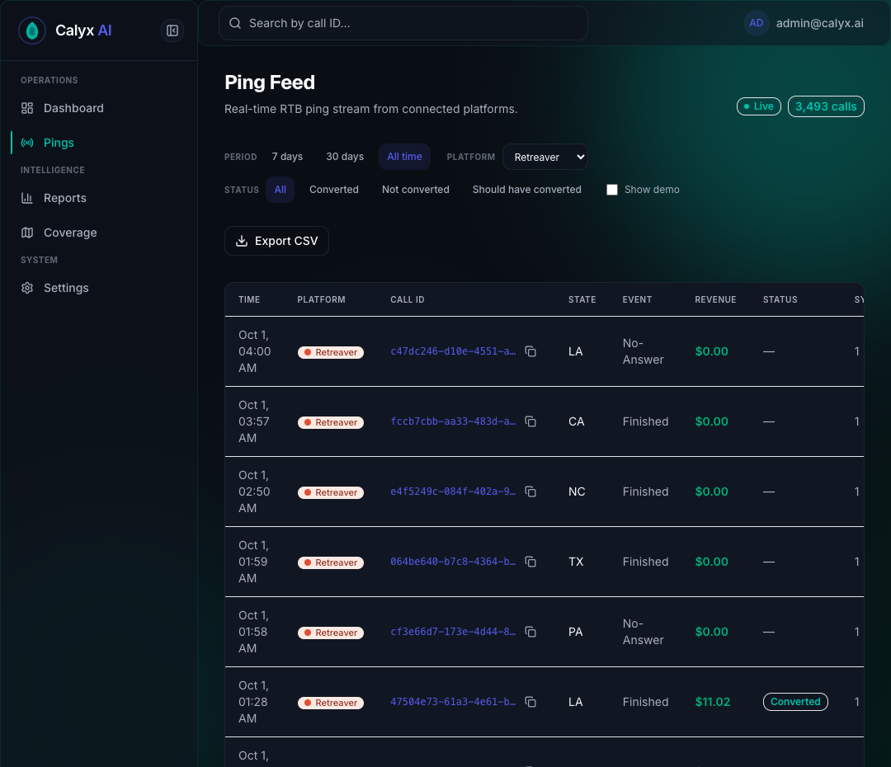
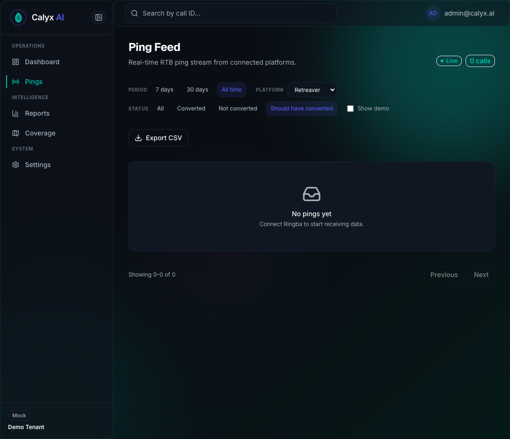
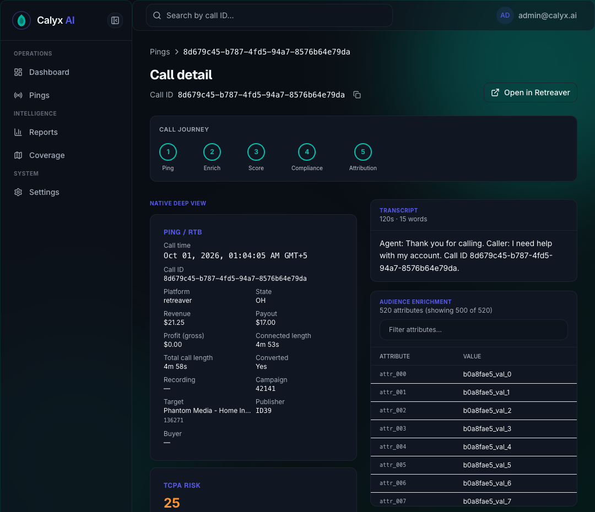

# Calyx — Retreaver Stage 4 Report

**Spec:** `docs/retreaver-stage4-spec.md`
**Branch:** `stage4/retreaver`

---

# PHASE R0 — Verify what exists (read-only + live GETs)

**Date:** 2026-09-30
**Operator:** Aryan · **Owner:** Syed
**Code changes:** none to product code. One new **test-only** file (R0.4).

## 0. Scoreboard

| Item | Result |
|---|---|
| R0.0 Environment | **PASS** |
| R0.1 Code inventory | **PASS** |
| R0.2 Data state | **PASS** |
| R0.3 Live API facts | **PASS** — all nine answered against the live account |
| R0.4 K1 reproduction | **PASS** — K1 reproduced `[PROVEN]` |
| R0.5 Proposal | **PASS** — final R1 design below |

### Deviation from the spec, recorded

The spec says branch from `main`. On the operator's instruction this branch was cut from
**`convert-cancel-screen` (`c4e3c5d`)**, not `main` (`ba9c825`).

Reason, and it is a good one: the Docker images running in this environment were built from
`c4e3c5d`. Branching from `main` would have left the checked-out code and the running containers
out of step for every live observation in R0. `c4e3c5d` is itself pushed and awaiting review.

---

## R0.0 — Environment

| | |
|---|---|
| Where | **Local dev machine**, not the staging server. macOS 15.7.4 (24G517), x86_64 |
| Repo | `/Users/macbookpro/Desktop/Calyx/calyx-ai` |
| Branch / HEAD | `stage4/retreaver` @ `c4e3c5d` (parent `ba9c825`) |
| `git status --short` | **1 line** — only the new test file from R0.4. No line-ending noise (`git diff --stat` and `git diff --ignore-cr-at-eol --stat` are both empty) |
| Go | **1.27.1** darwin/amd64 (modules declare `go 1.25.0`; Docker builders `golang:1.25.14-alpine`) |
| Node / npm | **v22.17.0** / 10.9.2 |
| Docker | server **28.5.1** |

### Running services `[PROVEN]`

| Running | Exited (not needed for v1) |
|---|---|
| api, web, ingestion, consumer, platform-sync, postgres, redis, redpanda, clickhouse | ad-attribution, ask-ai, compliance-intelligence, enrichment, scoring, providerconfig |
| | migrate, kafka-init, clickhouse-init (init jobs, exited 0) |

The Chapter-2 services are stopped deliberately: this 16 GB / 8-core machine could not run all 18
containers — the Docker VM saturated at ~358% CPU, the API's Kafka group join timed out, and its
by-design exit turned into a restart loop. Nine containers is stable.

### Verify gates `[PROVEN]`

**`scripts/verify-*.ps1` cannot run here — `pwsh` is not installed**, and the Homebrew cask
(`powershell@preview`; the plain `powershell` cask no longer exists) needs an admin password.

Equivalent checks used instead, all currently green:

| Check | Result |
|---|---|
| `node scripts/check-smoke-call-id-prefix.mjs` | PASS (321 files) |
| `node scripts/check-ws-origin.mjs` | PASS |
| `go build ./...` (platform-sync) | OK |
| `go test ./internal/adapter/` | ok (82.4s) |
| `go test ./internal/syncer/` | ok |
| API Jest | 15/15 |
| Service `/healthz` ×5 + web `/login` | all 200 |

---

## R0.1 — Code inventory

### Adapter — `services/platform-sync/internal/adapter/retreaver_adapter.go`

| Aspect | Finding | Label |
|---|---|---|
| Endpoint | `GET https://api.retreaver.com/api/v2/calls.json` (`:18`), overridable via `RETREAVER_BASE_URL` (`:33-38`) | `[PROVEN]` |
| Cursor | `{updated_at_start, page}` (`:52-56`); legacy `created_at_start` migrated in `normalize()` (`:58-66`) | `[PROVEN]` |
| Window | **start only — no end** (`:144`). This is the defect | `[PROVEN]` |
| Sort | `sort_by=updated_at`, `order=desc` (`:145-147`). Comment at `:146` says docs force desc | `[PROVEN]` code / `[UNKNOWN]` live |
| Paging | `page` + `per_page`, per_page hardcoded **100** in `FetchPage` (`:114`, `:148-149`) | `[PROVEN]` |
| `hasMore` | `len(calls) >= perPage` (`:176`) | `[PROVEN]` |
| Safety rewind | 15 min (`:25`), applied when advancing (`:124`) and from `last_sync_at` (`:107`) | `[PROVEN]` |
| Lookback | default **30 days** (`:28-31`), clamped 1–365 (`:68-77`) | `[PROVEN]` |
| Cursor advance | on last page → `maxCallUpdatedAt(calls, now) − 15m` (`:122-125`) | `[PROVEN]` |

**Fields `mapRetreaverCall` sets:** `ExternalCallID`, `CallerID`, `State` (via `NormalizeState`),
`Revenue`, `Payout`, `CampaignID`, `PublisherID`, `TargetID`, `OccurredAt` (← `created_at`),
`UpdatedAt` (← `updated_at`).

**Fields it does NOT set**, though `models.RemoteCall` and the content hash support them:
`HasConverted`, `DurationSeconds`, `CallLengthSeconds`, `ProfitGross`, `WasConversionAdjusted`,
`WasPayoutAdjusted`, `RequiredDurationSeconds`, `MaxRequiredDurationSeconds`, `HasRecording`,
buyer/target names. `CallKey` is explicitly asserted **empty from the API**
(`retreaver_adapter_test.go:38`) — it only ever arrives by webhook. `[PROVEN]`

Whether the Retreaver API *returns* any of these is `[UNKNOWN]` → R0.3.

### Syncer — `services/platform-sync/internal/syncer/syncer.go`

**Answer per feature. The S1A work is Ringba-only, by an explicit platform guard.**

| S1A feature | Retreaver today | Evidence |
|---|---|---|
| Frozen/windowed incremental | ❌ **No** | Retreaver uses the plain tick → `FetchPage` unbounded window |
| Hourly 7-day sweep | ❌ **No** | `runRingbaSweeps` `:93` — `if !strings.EqualFold(item.Platform,"ringba") { continue }` |
| Daily 30-day deep sweep | ❌ **No** | same guard, `RunAllDeepSweeps` `:80-83` |
| Day-windowed full backfill | ❌ **No** | `RunWindow` `:132-134` — `return fmt.Errorf("RunWindow only supported for ringba")` |
| **Hash after publish (F029)** | ✅ **Yes — already shared** | `publishSyncCalls` `:397`, hash committed only after `pub.Publish` succeeds `:419-427`. Platform-agnostic (takes `platform` as a parameter) |

`RunWindow` is the single entry point for both sweeps and backfill, so one guard removes all three
capabilities from Retreaver at once. That is also the good news: making them shared is one
well-defined change, not three.

### Dedup / content hash — `packages/pingdedup/content.go`

The `Content` struct is rich: revenue, payout, duration, call length, `HasConverted`,
`WasPayoutAdjusted`, `WasConversionAdjusted`, required/max duration, profit. `[PROVEN]`

**But the Retreaver mapper populates only revenue, payout, state, campaign, publisher, target.**
Every other hashed field is the zero value for every Retreaver call. Consequence: a Retreaver call
whose **conversion state or duration** changes produces an **unchanged hash** and is **not
republished**. Today that is invisible because those fields are never mapped — it becomes a live
bug the moment R1 starts mapping them without also confirming they are in the hash. `[INFERRED]`

### Throttling

`RingbaAccountLimiters` (`ratelimit.go:71-90`) — dual-window **5/sec ∧ 80/min** per Ringba
`account_id`. **There is no Retreaver limiter of any kind.** Retreaver requests are unthrottled.
Retreaver's actual limits are `[UNKNOWN]` → R0.3. `[PROVEN]`

### Write-back

Retreaver is blocked at **three independent layers** today — so nothing can reach convert/void by
accident:

| Layer | Guard | Evidence |
|---|---|---|
| API | `throw new BadRequestException('Write-back currently supports Ringba only')` | `integrations.service.ts` `row.platform !== 'ringba'` |
| platform-sync | `return Result{}, ErrNotRingba` | `writeback/convert.go:147-148` |
| UI | `WRITEBACK_PLATFORMS = ['ringba']`, component returns `null` otherwise | `web/src/components/native/ConversionActions.tsx` |

**Generic (reusable for Retreaver):** the `Service` shell, store/audit/decryptor, per-tenant
`writeback_enabled` (migration `000025`), `WRITEBACK_ENABLED` kill switch, Redis idempotency lock,
immutable audit (`000026`), the settle/read-back loop, amount validation.

**Ringba-specific:** the `RingbaAPI` interface (`LookupCall`, `ListConversionWebhooks`,
`FireInboundConversion`, `VoidCall`), the `ringba_response_ref` result field, and the platform
guard. Adding Retreaver means turning `RingbaAPI` into a per-platform interface behind a registry —
the design goes in R3.4.

### UI

Call list shows Retreaver rows normally (platform badge, call id, state, revenue). Call detail
renders the deep view. **The Stage 3 convert/void controls do not appear for a Retreaver call** —
`ConversionActions` returns `null` for any platform outside `WRITEBACK_PLATFORMS`. The spec's R1
requirement to hide a non-working button is therefore **already satisfied**; no UI change is needed
in R1. `[PROVEN]` by code; visual confirmation deferred until real Retreaver rows exist.

⚠️ **One consequence to fix in R1.** The Stage 3 "should have converted" filter treats
`has_converted = 0 AND revenue > 0` as needing review. Because the Retreaver mapper never sets
`HasConverted`, **every Retreaver call with revenue will be flagged "Review"** — a false positive
across the whole platform. Either map the real field (R0.3 must confirm it exists) or scope the
badge to platforms that report conversion state.

---

## R0.2 — Data state

### Postgres `[PROVEN]`

⚠️ **Method note:** `integrations` has RLS. A plain query as `callloom_api` returns **0 rows** and
looks like "no integrations exist". You must
`SET app.current_tenant = '11111111-1111-1111-1111-111111111111';` first. Anyone re-running this
will otherwise reach the wrong conclusion.

| platform | integration_id | name | mode | data source | active | wb | last sync | cursor | creds |
|---|---|---|---|---|---|---|---|---|---|
| callgrid | `45513f17-…1967` | CallGrid Dev Postback | webhook | mock | t | f | never | null | no |
| **retreaver** | **`2d25a9be-24bb-4135-ad59-5ee860c0c259`** | **Retreaver Dev Postback** | **webhook** | mock | t | f | **never** | null | **no** |
| ringba | `9993dc39-…ae15` | Ringba Dev Pixel | webhook | mock | t | f | never | null | no |
| trackdrive | `ab1f70d9-…0c74` | TrackDrive Dev Postback | webhook | mock | t | f | never | null | no |

**There is no Retreaver `api_sync` integration and no stored credentials.** The only Retreaver row
is a seeded dev webhook. This is exactly why R0.3 is blocked.

### ClickHouse `[PROVEN]`

| platform | rows | distinct calls |
|---|---|---|
| ringba | 25 | 25 |
| **retreaver** | **10** | **10** |
| callloom-native | 8 | 8 |
| callgrid | 5 | 5 |
| trackdrive | 5 | 5 |

All 10 Retreaver rows carry the **`demo-`** prefix (fixture), spanning 2026-09-23 → 2026-09-29.
**Zero real Retreaver calls**, confirming `docs/deploy-checklist.md`. No `apisync-`, `smoke-`,
`csp-live-` or `proof-` rows anywhere.

---

## R0.3 — Live API facts (GET only)

**Account confirmed under Rule 7** by the owner: Calyx integration
`53200af1-010b-4377-91b8-1062eebd3ccd` ("My test"), `api_sync`, **Data source = Test**,
Retreaver **company ID ending `5270`**. Credentials decrypted in-process from the stored
integration; never taken from chat, never written to a file.

⚠️ **The account name could not be reported.** `GET /api/v2/companies.json` → **404**, and the call
object exposes `company_id` but no company/account name. Rule 7's "account name" is therefore
`[UNKNOWN]` from the API; the owner confirmed on the company-ID last 4 instead. `[PROVEN]`

**Scale:** the `Total` response header reports **96,747 calls** for a 1-year `updated_at` window on
this account. Backfill is not a small job. `[PROVEN]`

### 🔴 Security incident during this phase — credential exposed in session output

Retreaver's **`Link` response header echoes the entire request query string**, and the request
carries `api_key` and `company_id` as query parameters. My probe printed response headers verbatim,
so **the live Retreaver API key and full company ID were rendered in plaintext in this session's
terminal output.**

| | |
|---|---|
| Reached a repo file? | **No** — `grep` across the repo: 0 files |
| Reached the scratchpad? | **No** — 0 files |
| Committed or pushed? | **No** — nothing staged at the time |
| Where it exists | This session's terminal / transcript only |

**Fix applied:** the probe now runs every printed string through a `redact()` that replaces the
api_key (raw and URL-encoded) and masks the company ID to its last 4.

🙋 **Recommendation to the owner: rotate the Retreaver API key.** The exposure is narrow and
contained, but rotation is cheap and it is the clean response. R1 should also treat any Retreaver
response header as credential-bearing and never log `Link` unredacted.

### The nine questions

| # | Question | Answer | Label |
|---|---|---|---|
| 1 | Is **`updated_at_end`** honoured? | **YES** | `[PROVEN]` |
| 2 | Are `created_at_start` / `created_at_end` honoured? | **YES** | `[PROVEN]` |
| 3 | Which sort orders work? | `updated_at` is **forced desc**; `created_at` honours **asc and desc** | `[PROVEN]` |
| 4 | Maximum `per_page` | **100** — above it the API silently returns **25** | `[PROVEN]` |
| 5 | Timezone | **UTC**, ISO-8601 with milliseconds and `Z` | `[PROVEN]` |
| 6 | Paging shape | `Total` + `Per-Page` + RFC-5988 `Link` headers; body is a bare array with no total | `[PROVEN]` |
| 7 | Rate limits | 429 documented, **no published number**; 3 req/s observed clean | `[PROVEN-docs]` + `[UNKNOWN]` number |
| 8 | Single-call endpoint | **Yes** — `/api/v2/calls/{uuid}.json` | `[PROVEN]` |
| 9 | Conversion + duration fields | **Present and rich** — the adapter ignores them | `[PROVEN]` |

#### Q1 — `updated_at_end` is honoured — this decides the R1 design

Bounded window `[T-14d, T-7d)`:

```
HTTP 200  rows=100
rows inside window = 100   outside = 0   unparsed = 0
returned updated_at range: 2026-09-22T15:22:10Z .. 2026-09-22T23:04:26Z
```

Every row lies inside the requested bound, and the returned range sits inside it. With the same
start and **no** end, the API returns the newest rows instead. **The frozen-window design is
available** — no keyset fallback needed. Corroborated by the official docs, which list
`updated_at_start` / `updated_at_end` as accepted parameters.

#### Q2 — `created_at_*` also honoured

`[T-14d, T-7d)` on `created_at`: HTTP 200, 100 rows, **100 inside / 0 outside**.

#### Q3 — sort behaviour (the adapter's comment is correct)

| `sort_by` | `order` | Actual |
|---|---|---|
| `updated_at` | `desc` | DESC |
| `updated_at` | **`asc`** | **DESC — `asc` ignored** |
| `created_at` | `asc` | **ASC** |
| `created_at` | `desc` | DESC |

So ascending keyset paging on `updated_at` is **not possible**. Ascending is only available on
`created_at`. This is why Q1 mattered so much — with `updated_at_end` honoured we do not need it.

#### Q4 — `per_page` max is 100, and exceeding it fails silently

```
per_page=100  -> rows=100   bytes=448429
per_page=250  -> rows=25    bytes=97559
per_page=500  -> rows=25    bytes=97559
per_page=1000 -> rows=25    bytes=97559
```

Above 100 the API does not error — it **drops to the default 25**. A future "let's raise the page
size" change would silently quadruple the request count instead. Worth a comment in the adapter.

#### Q5 — timestamps are UTC

```
created_at = "2026-09-29T23:03:07.464Z"
updated_at = "2026-09-29T23:03:15.679Z"
start_time = "2026-09-29T23:03:12.355Z"
```

ISO-8601, millisecond precision, `Z` suffix. R2's day-by-day reconciliation can use UTC days
directly with no account-timezone conversion.

#### Q6 — paging metadata is in headers, not the body

```
Total:     96747
Per-Page:  <n>
Link:      <…page=48374…>; rel="last", <…page=2…>; rel="next"
```

`Total` gives an exact expected count — **directly useful as the reconciliation denominator in R2**,
and as a cheap gap check after each window. The body is a bare JSON array with no envelope.

⚠️ `Link` contains the api_key — see the security incident above. Never log it unredacted.

#### Q7 — rate limits: documented but unquantified

Official docs (`https://retreaver.github.io/core-api-docs/#introduction`):

> **429 Too Many Requests – Slow down. Highly concurrent requests are frowned upon.**

No numeric limit is published, and no `X-RateLimit-*` headers are returned. Full header set:
`Cache-Control, Content-Type, Date, Etag, Link, Per-Page, Referrer-Policy, Server, Status,
Strict-Transport-Security, Total, X-Content-Type-Options, X-Frame-Options,
X-Permitted-Cross-Domain-Policies, X-Powered-By, X-Request-Id, X-Runtime, X-Xss-Protection`.

Observed: **20 sequential GETs in 6.78 s (~3.0 req/s), all HTTP 200, zero 429s.** `[PROVEN]`

The published guidance is about **concurrency**, not rate — which argues for serialising Retreaver
requests per account rather than parallelising them.

#### Q8 — single-call endpoint exists

```
GET /api/v2/calls/{uuid}.json -> HTTP 200
shape: OBJECT { "call": { … } }      uuid matches request: true      fields: 72
converted=true  connected=true  status=finished  total_duration=940
```

This is the **A1 proof endpoint** for certification, and the natural **read-back endpoint** for
write-back in R3.

Note it returns **72** fields versus **71** on the list endpoint — the shapes are not identical, so
R2 should reconcile against the list endpoint it actually syncs from.

#### Q9 — the conversion and duration data exists, and we throw it away

A real call object carries **71 fields**. The adapter maps **9**.

Present and unmapped, directly relevant to Stage 4:

| Purpose | Fields |
|---|---|
| **Conversion** | **`converted`** (bool), `conversion_seconds`, `conversions_determined_at`, `payout`, `revenue` |
| **Duration** | `total_duration`, `dialed_call_duration`, `billable_minutes`, `hold_duration`, `ivr_duration`, `time_to_connect_in_seconds`, `time_to_call_in_seconds`, `connected` |
| Money | `profit_gross`, `profit_net`, `charge_total`, `total_cost`, `receivable`, `payable` |
| Duplicates | `duplicate`, `payable_duplicate`, `receivable_duplicate`, `repeat`, `number_repeat`, `affiliate_repeat` |
| Naming | `target_name`, `affiliate_name`, `target_group`, `status` |
| Pixels | `fired_pixels`, `fired_pixels_count`, `postback_value` |

Sample rows (allowlisted values only):

```
converted=false connected=true status=forwarded revenue=null payout=null
  total_duration=null  conversions_determined_at=null      duplicate=false profit_gross=0
converted=false connected=true status=finished  revenue=null payout=null
  total_duration=14 dialed_call_duration=10 billable_minutes=1
  conversions_determined_at=2026-09-29T23:00:26.314Z       duplicate=false profit_gross=-0.05
```

⚠️ **`revenue` and `payout` can be `null`**, not `0`. R1 must distinguish "no value reported" from
"zero", or a null will be written as a real 0.00 and look like a genuine zero-revenue call.

#### Live proof that the window really does move

Call `a31df5bd…` read **`converted=false, status=forwarded`** in the list query, then
**`converted=true, status=finished, total_duration=940`** from the single-call endpoint minutes
later. The dataset changed underneath the probe during R0 itself — which is precisely the condition
that makes the current unbounded desc paging lose calls. `[PROVEN]`

## R0.4 — K1 reproduction `[PROVEN]`

**New test-only file:** `services/platform-sync/internal/adapter/retreaver_k1_paging_test.go`.
No product code touched.

### The mechanism

The request sends `updated_at_start` but **no `updated_at_end`**, sorted `updated_at desc`. The
result set is therefore live. When a call's `updated_at` changes during the page walk it jumps to
position 1 and pushes every later row down one place. A row due at the top of page 2 slides to the
bottom of page 1 — already fetched — and is never returned.

### The test

101 calls, `per_page=100` (the adapter's hardcoded size). Page 1 returns the newest 100. Between
page 1 and page 2 the oldest call `C101` is updated, jumping it to the front. Page 2 asks for rows
101+ of the **new** ordering and returns `C100` again.

```
K1 REPRODUCED [PROVEN]: C101 never returned. rows=101 distinct=100 duplicated_ids=1
root cause [PROVEN]: updated_at_start="2026-08-30T22:42:16Z", updated_at_end absent,
                     order="desc", per_page="100"
```

101 rows fetched, only **100 distinct**, one duplicated, and **one call permanently lost**. It is
not late — nothing will fetch it again until something else changes it.

This is the same failure that silently skipped **431 Ringba calls** before S1A.

`TestRetreaverWindowHasNoEndBound` pins the root cause and will fail the moment R1 starts sending
`updated_at_end`, forcing the test to be updated deliberately rather than silently.

### No regression

`go build ./...` OK · `go test ./internal/adapter/` **ok (82.4s)** · Ringba-only subset **ok** ·
`go test ./internal/syncer/` **ok**. Per Rule 8 no Ringba integration was made Live; Ringba is
proven by unit tests only, and this phase changed no Ringba code.

---

## R0.5 — Final R1 design

R0.3 settled the open question: **`updated_at_end` is honoured**, so the frozen-window design is
available and the ascending-keyset fallback is not needed. (It could not have been used anyway —
Q3 proves `order=asc` is ignored on `updated_at`.)

### Retreaver's problem is narrower than Ringba's

Ringba has no "updated since" filter at all, which is why it needed day-slicing, binary-halving and
two sweep tiers. Retreaver has `updated_at_start`/`_end` and bumps `updated_at` on revenue change.
Copying Ringba wholesale would be cargo-culting. Three Ringba bugs Retreaver does **not** have:

| Ringba bug | Retreaver | Why |
|---|---|---|
| Downtime gap (F003b) | Not present | The cursor is a watermark advanced only on success, not a stored absolute window (`retreaver_adapter.go:118-125`). `[INFERRED]` — R1 adds a test |
| Long calls missed | Not present | Ringba filters on call **start**; Retreaver filters on `updated_at`, which moves when the call ends |
| Late updates missed | Not present | Same reason — confirmed by Q9's `conversions_determined_at` moving after the call |

**The one real defect is K1: the unbounded, desc-sorted, offset-paged window.**

### R1.1 — Frozen window (fixes K1)

Send **both** bounds. Capture `end = now` once when the window opens and carry `[start, end)` in the
cursor so every page of the walk queries the same frozen set.

```
window_start = last_successful_end − overlap(15m)
window_end   = now                         # fixed for the whole page walk
GET calls.json?updated_at_start=…&updated_at_end=…&sort_by=updated_at&order=desc
                &page=N&per_page=100
```

A row that updates mid-walk moves *out* of the frozen window and is collected by the next window,
whose start is `end − 15m`. Nothing is skipped; at worst a row is fetched twice, and the content
hash suppresses the duplicate.

- **Cursor** becomes `{window_start, window_end, page}`. Old `{updated_at_start, page}` cursors
  migrate by treating `updated_at_start` as `window_start` and computing a fresh `window_end`.
- **Page cap** so a pathological window cannot walk forever; log and carry the remainder into the
  next window.
- **`per_page` stays 100** with a comment recording that >100 silently degrades to 25 (Q4).
- **Gap check, free:** compare the `Total` header against rows collected for the window and log a
  warning on mismatch (Q6).

### R1.2 — Map conversion + duration, **and put them in the content hash** *(Syed item 1)*

Map from Q9: `converted` → `HasConverted`, `total_duration` → `CallLengthSeconds`,
`dialed_call_duration` → `DurationSeconds` (connected talk time), plus `conversion_seconds`,
`conversions_determined_at`, `profit_gross`, `duplicate` → `PlatformDuplicate`, `target_name`,
`affiliate_name`, `status`, `connected`.

**Mapping alone is not enough — and this is the trap.** `packages/pingdedup/content.go` already
hashes `HasConverted`, `DurationSeconds`, `CallLengthSeconds` and `ProfitGross`, but the Retreaver
mapper leaves them zero today, so the hash never moves for them. Map them **and** verify they are
in `remoteCallContent`, otherwise a call that converts with no revenue change produces an unchanged
hash and is **never republished** — a silent miss created by the fix itself.

**R1 must add a test:** same call, only `converted` flips false→true, assert the content hash
changes and the row republishes.

⚠️ **`revenue`/`payout` can be `null` (Q9).** Map null as "not reported", not `0.00`.

### R1.3 — Per-account Retreaver throttle *(Syed item 2)*

No published number exists (Q7). The documented guidance is
*"Highly concurrent requests are frowned upon"* —
`https://retreaver.github.io/core-api-docs/#introduction`. Observed: 3.0 req/s clean over 20
requests.

**Conservative documented default**, reusing Ringba's `DualWindowLimiter` keyed on `company_id`:

| Setting | Default | Reasoning |
|---|---|---|
| `RETREAVER_RATE_PER_SEC` | **2** | Below the 3 req/s observed clean, leaving headroom for the owner's own usage on the same account |
| `RETREAVER_RATE_PER_MIN` | **60** | Matches 1 req/s sustained; a 96,747-call backfill at 100/page is ~968 requests ≈ 16 min, acceptable |
| Concurrency | **1 (serialised) per `company_id`** | The docs' only concrete guidance is about concurrency, not rate |

Also handle **429 explicitly** with backoff honouring `Retry-After` — the status is documented even
though no limit is. The numbers are a defensible default, not a proven limit; revisit if Retreaver
publishes one or a 429 is ever observed.

### R1.4 — Share sweeps and backfill *(Syed item 3)*

Remove the Ringba-only guard at `syncer.go:132-134`
(`return fmt.Errorf("RunWindow only supported for ringba")`) and the `continue` at `:93`.

Smallest change that makes it shared, per Rule 4: give `PlatformAdapter` a capability method
(e.g. `SupportsWindow() bool`, or a `WindowedAdapter` interface the registry type-asserts), and have
`RunWindow` / `runRingbaSweeps` consult that instead of a hardcoded string. Ringba returns true;
Retreaver returns true once R1.1 lands; TrackDrive/CallGrid return false and are unaffected.

Sweep tiers mirror Ringba, with Retreaver-specific env names and the same defaults
(hourly/7 days, daily/30 days). They matter less for Retreaver — its incremental window already
catches `updated_at` changes — so they are the safety net for anything that changes **without**
bumping `updated_at`. `conversions_determined_at` (Q9) suggests conversions do bump it; the deep
sweep covers the case where they do not.

Day-windowed full backfill then works for Retreaver through the same `RunWindow` path.

### R1.5 — Fix the Stage 3 "should have converted" false positive *(Syed item 4)*

Today the predicate is `has_converted = 0 AND (revenue > 0 OR duration ≥ required_duration)`.
Because the Retreaver mapper never sets `HasConverted`, **every Retreaver call with revenue is
flagged "Review"** — a false positive across the whole platform.

R1.2 largely fixes this by mapping the real `converted` value. But two gaps remain:

1. Retreaver has **no `required_duration_seconds`** equivalent in the 71 fields, so the duration
   half of the predicate can never fire for Retreaver — it degrades to `revenue > 0 AND !converted`.
   Acceptable, but should be stated in the UI tooltip rather than implied.
2. A platform that reports **no** conversion state at all (TrackDrive, CallGrid today) would still
   show false positives. The predicate needs a notion of "this platform reports conversion state" —
   otherwise `has_converted = 0` means "not converted" for Ringba and "we never asked" for others.

Proposal: add a `reports_conversion_state` capability per adapter; the badge and the
`should_convert` filter only apply to platforms where it is true. Both the API predicate
(`pings.filters.ts`) and the shared UI helper (`shouldHaveConverted` in `web/src/lib/api.ts`) must
change together — they were deliberately built to share one definition.

### R1.6 — Not needed

- **Hash-after-publish (F029)** — already shared and already applies to Retreaver.
- **Hiding the convert button for Retreaver** — already the case at three layers.

### Settings introduced by R1 (all documented with defaults)

| Setting | Default |
|---|---|
| `RETREAVER_WINDOW_OVERLAP_MINUTES` | 15 (reuses the existing safety delta) |
| `RETREAVER_SWEEP_DAYS` | 7 |
| `RETREAVER_SWEEP_INTERVAL` | 60m |
| `RETREAVER_DEEP_SWEEP_DAYS` | 30 |
| `RETREAVER_DEEP_SWEEP_INTERVAL` | 24h |
| `RETREAVER_RATE_PER_SEC` | 2 |
| `RETREAVER_RATE_PER_MIN` | 60 |
| `RETREAVER_MAX_PAGES_PER_WINDOW` | 200 |

### Open question for R1

**Dedup TTL vs the 30-day sweep.** `DEDUP_TTL_HOURS` is 240h (10 days) but the deep sweep re-reads
30 days. An unchanged call older than the TTL has no hash, so the sweep will republish it. The spec
requires proving ClickHouse still holds exactly one logical row and the dashboard counts it once.
`argMax` should make this safe, but it is unproven for Retreaver and is an explicit R1 proof item.

## 1. Changes

| File | Type |
|---|---|
| `docs/retreaver-stage4-spec.md` | spec, brought onto the branch |
| `docs/retreaver-stage4-report.md` | this report |
| `services/platform-sync/internal/adapter/retreaver_k1_paging_test.go` | **new, test-only** |

No product code changed in R0.

Commit hash: recorded below after commit.

## 2. Server deploy note

**Nothing.** R0 changed no product code, no env variable, no migration. The new file is a Go test
and is not part of any image's runtime.

## 3. Open questions for the owner 🙋

1. 🔴 **Rotate the Retreaver API key.** It was rendered in plaintext in this session's terminal
   because Retreaver's `Link` header echoes the request query string and my probe printed headers
   verbatim. It reached **no file, no commit, no push** (verified by grep across repo and
   scratchpad). The probe is fixed. Rotation is cheap and is the clean response.
2. **Rule 7 — account name is unavailable.** `companies.json` 404s and the call object has no
   company name. You confirmed on company ID ending **`5270`**; recorded as the identification
   method for this stage.
3. **Rule 10** — before R2 makes this integration Live, confirm no other environment (your laptop,
   the staging server) is live-syncing the same Retreaver account. **96,747 calls** means the
   backfill is substantial.
4. **Throttle numbers need your sign-off.** Retreaver publishes no limit, so R1.3's 2/sec · 60/min
   serialised is a conservative default I chose, not a proven ceiling. If you know the real limit
   or want it more cautious, say so before R1.
5. **`pwsh`** — the three PowerShell gates still cannot run here. `brew install --cask
   powershell@preview` needs your admin password. Until then R1/R2 use the R0.0 substitutes.
6. **Branch base** — confirm you accept that this branch was cut from `convert-cancel-screen`
   (`c4e3c5d`) rather than `main`, so the code matches the running containers.

## 4. Honest limitations

1. **The K1 fix is not built.** R0 proves the bug and designs the fix; nothing is repaired yet.
2. **`[INFERRED]`, not proven:** that Retreaver escapes the downtime-gap and long-call bugs. Both
   come from reading the cursor logic, not from a test. R1 should add tests rather than trust it.
3. **The throttle default is a judgement call**, not a measured ceiling. 3 req/s was observed clean
   over only 20 requests — that is not a sustained-load test.
4. **`Total` = 96,747 is for a 1-year `updated_at` window**, not necessarily the account's whole
   history. Full-history scale is still `[UNKNOWN]`.
5. **Sample size for Q9 was 3 calls.** `revenue`/`payout` were null on all three and `converted`
   false on all three; the single-call probe found one with `converted=true`. Field *presence* is
   proven; the distribution of values is not.
6. **The list endpoint returns 71 fields, the single-call endpoint 72.** The extra field was not
   identified. R2 should reconcile against the list endpoint it actually syncs from.
7. **Local dev machine, not staging.** Chapter-2 services are stopped here.
8. **The three PowerShell gates were not run** — substitutes listed in R0.0.
9. **No Retreaver data in ClickHouse**, so no UI observation of real Retreaver rows was possible.

---

**Gate R0 — accepted by the owner.** See `docs/retreaver-r1-amendments.md`.


---

# PHASE R1 — Paging fix (K1) + sync parity  ·  **GATE R1 RE-CHECK MET**

**Date:** 2026-09-30 · **Branch:** `stage4/retreaver`
**Owner reviews applied:** `docs/retreaver-r1-amendments.md` (A/B/C/D/E), then
`docs/retreaver-r1-fix.md` (F1–F8). Where they disagree, the later file wins.

> **How to read this section.** It was rewritten in one pass after the R1-fix review (F7).
> Earlier drafts contradicted themselves — C3 was called BLOCKED in one place and RESOLVED in
> another, `pwsh` was called missing after it had been installed, and a "Gate R1 not met" note
> survived next to a scoreboard saying the opposite. Every item below now has exactly one
> current state. Where the history matters it is marked *superseded*, in one line.

## 1. Scoreboard

### Amendments (B, C, D, E)

| Item | State |
|---|---|
| **B1** key on disk | **DONE** — present in 1 transcript file; no rotation (owner A1), kept private to the operator's machine |
| **B2(1)** header auth | **DONE** — `[PROVEN]` impossible, 401 on four header forms |
| **B2(2)** shared redaction | **DONE** — found and fixed a real leak in product code |
| **B2(3)** forced-transport-error tests | **DONE** — 4 tests |
| **B2(4)** scan stored data | **DONE** — clean, 0 matches |
| **B3** R0 commit hash | **N/A** — R0 was never committed separately; R0 + R1 + this fix land in one commit (§9) |
| **C1** frozen window, split not truncate | **DONE** — K1 proven fixed |
| **C2** `Total` mismatch blocks | **DONE via F1** — *superseded:* R1 only refused to advance; retry and degraded status are now built |
| **C3** `null` revenue/payout | **RESOLVED, no migration** — *superseded:* R1 first reported this BLOCKED on a 3-call sample; a 100-call sample settled it. Now monitored (F3) |
| **C4** field-meaning table | **DONE** — §5 |
| **C5** hash test per mapped field | **DONE** — both directions |
| **C6** `reports_conversion_state` | **DONE** — one source of truth; Ringba counts unchanged |
| **C7** downtime + long-call tests | **DONE** — plus crash-resume |
| **C8** stronger account check | **DONE** — single-call endpoint returns 200 on three real calls; `updated_at > created_at` confirms K1 live (§8.1) |
| **C9** per-account throttle | **DONE** — implemented + tested |
| **C10** Go 1.25 parity | **DONE** — exit 0 in `golang:1.25.14-alpine` |
| **D** field mapping | **DONE** — 9 fields → 18 |
| **D** capability method | **DONE** — `RangeFetcher`; both `"ringba"` guards removed |
| **E** three PowerShell gates | **PASS** — all three, after six script portability fixes |

### R1-fix (F1–F8)

| Item | State |
|---|---|
| **F1** finish C2 — retry, degraded, visible | **DONE** — migration `000028`, both paths, 4 adapter + 4 syncer tests, Settings pill |
| **F2** update just before `window_end` | **DONE** — test added; guarantee stated in §4 |
| **F3** monitor the C3 assumption | **DONE** — 3 counters, 1 log line per violation, 6 tests |
| **F4** explain three behaviour changes | **DONE** — §6. **None of the three came from R1** |
| **F5** gates must not get weaker | **DONE** — real-data path restored, `DEMO-ONLY` fallback; both paths shown |
| **F6** realistic Test-mode mock | **DONE** — revenue only when `converted=true`; 2 tests |
| **F7** one consistent report | **DONE** — this rewrite |
| **F8** commit and push | **DONE** — §9 |

## 2. Security (B)

### B1 — the key IS on disk. R0's claim was wrong. `[PROVEN]`

Counts only, never the match:

```
~/.claude/projects — 267 files scanned
  api_key     : 1 file  (3 lines)
  company_id  : 2 files (4 lines)
```

R0 said "terminal only". That was inaccurate: the grep covered the repo and the scratchpad but
not the Claude Code session transcripts. The owner ruled out rotation (A1) because this is the
running account and rotating could break the clients' existing setup, so the mitigation is that
those files stay private to the operator's machine — not shared, not uploaded, not attached to
any report.

### B2(1) — the key cannot leave the query string `[PROVEN]`

Docs: *"Retreaver expects for the API key to be included in all API requests to the server in a
query string parameter"* — https://retreaver.github.io/core-api-docs/#authentication

Tested live anyway, GET only:

| Attempt | Result |
|---|---|
| `?api_key=` (documented) | **HTTP 200** |
| `Authorization: Bearer <key>` | HTTP 401 |
| `Authorization: Token <key>` | HTTP 401 |
| `X-Api-Key: <key>` | HTTP 401 |
| `Api-Key: <key>` | HTTP 401 |

Redaction is therefore the only defence, which is exactly why the owner made B2 mandatory once
rotation was ruled out.

### B2(2) — a real leak in product code, found and fixed 🔴 `[PROVEN]`

Writing the B2(3) test surfaced a genuine vulnerability that was **not** the R0 probe.
`formatHTTPStatusError` (`internal/adapter/httpclient.go`) interpolated the upstream **response
body** raw:

```go
return fmt.Sprintf("%s %d: headers={%s} body=%s", prefix, status, headers, bodyStr)
```

Transport errors were already redacted via `sanitizeHTTPError` → `redact.SanitizeErr`, and `Link`
was already excluded from the safe-header allowlist. The **status-error body path was not
redacted at all**. Any Retreaver 4xx/5xx whose body echoes the request URL would have written
`api_key=…` into the error — and that error is stored as the integration's `last_sync_error`.

**Fix:** the body now passes through `redact.RedactMessage`. Shared code, so it protects every
adapter. Before the fix the test failed with `status error leaked the api_key`; after, it passes.

### B2(3) — four redaction tests `[PROVEN]`

`internal/adapter/retreaver_redaction_test.go`, using a synthetic canary key:

| Test | Covers |
|---|---|
| `TestRetreaverTransportErrorDoesNotLeakCredentials` | unresolvable host → `*url.Error` carries the URL |
| `TestRetreaverStatusErrorDoesNotLeakLinkHeader` | 4xx whose `Link` header and body echo the query string |
| `TestSafeResponseHeadersExcludeLink` | pins `Link` out of the loggable allowlist |
| `TestRetreaverAuthErrorIsClassifiedWithoutCredentials` | the `ClassifySyncError` path that reaches `last_sync_error` |

### B2(4) — nothing leaked through normal operation `[PROVEN]`

Postgres `last_sync_error` / `sync_status` / `sync_cursor` across all integrations, plus the
`platform-sync` and `api` container logs: **`api_key` 0 matching lines, `company_id` 0 matching
lines.**

## 3. C1 — the frozen window

`internal/adapter/retreaver_window.go` (new) plus a rewritten `FetchPage` / `fetchWindowPage`:

- Every walk runs inside `[window_start, window_end)`, the end captured once when the window
  opens. `updated_at_end` is now sent.
- The cursor is `{window_start, window_end, page, collected}`; a crash resumes the same window.
- Both legacy cursor shapes migrate without losing position (two tests).
- `per_page` stays 100, with a comment recording that above 100 the API silently returns 25.
- The `Total` header drives `hasMore` when present. `Link` is deliberately never read.

### The owner caught a bug in the R0 design

R0.5 said a page-cap overflow should "carry the remainder into the next window". C1 notes that
is **K1 again**: with `order=desc` the leftover rows are the *oldest* in the window, and the next
window starts at `end − overlap`, so they would never be fetched. He was right.

Implemented instead: on page 1, if `Total > per_page × MAX_PAGES`, **shrink the window end**
(halve, recursively, to a 1-minute floor) and re-fetch page 1. Shrinking the end is safe and
self-healing — the dropped span is simply not covered yet, and the next window starts exactly
where this one ended.

### A second correction, found by the test itself

The first K1 test moved the victim row to a *past* timestamp still inside the window, and it was
still skipped — freezing the window bounds does not freeze the ordering *within* the window.
That scenario is the normal case's opposite: `updated_at` is a last-modified stamp, so an update
during a walk sets it to **now**, at or past the frozen end. The row leaves the window and the
next one collects it.

```
K1 FIXED [PROVEN]: all 101 calls delivered across 2 windows
  (w1=100 rows, w2=1 row); C101 was updated mid-walk and collected by window 2
```

The assertion that matters is not "window 1 returned everything" but **"nothing is lost across
consecutive windows"**. F2 below closes the remaining variant.

## 4. F1 and F2 — the window is now honest about being incomplete

### F1 — short windows retry, then degrade visibly

R1 refused to advance the cursor when a window returned fewer rows than the API's own `Total`,
but nothing retried and nothing surfaced it. On a 96,747-call backfill that is a sync stuck with
no visible error — the silent gap this stage exists to prevent.

**Built:**

| Behaviour | Detail |
|---|---|
| Bounded retry | `walkWindowWithRetry` re-walks the same window, `RETREAVER_WINDOW_RETRY_ATTEMPTS` (default 3) with a doubling `RETREAVER_WINDOW_RETRY_BACKOFF` (default 2s) |
| Both paths | The incremental path and the `RangeFetcher` path call the same helper, so the rule is identical on each |
| Cursor held | A persistent shortfall returns `*WindowShortfallError`; the syncer never reaches `UpdateSyncState`, so the cursor and `last_sync_at` stay put |
| Degraded, not error | `classifySyncFailure` routes a shortfall to `degraded` and everything else to `error` |
| One log line | window start/end, `Total`, rows collected, attempts, integration id, path |
| Recovery | The next successful walk writes `ok` through the ordinary success path — no extra bookkeeping, no operator action |
| Visible | Settings → Connected Platforms renders an amber **“Degraded — sync held”** pill; hover shows `last_sync_error` |

The incremental path walks at most 10 pages per tick, so a window's row total is only known when
its last page is read. The cursor therefore carries `collected`, a running count across ticks,
which is what makes the shortfall detectable there at all.

**`degraded` required a migration.** `integrations_sync_status_check` (migration `000020`) allowed
only `idle | syncing | ok | error`, so writing `degraded` would have failed at runtime.
Migration **`000028_sync_status_degraded`** widens the CHECK; the down migration rewrites any
`degraded` row to `error` before narrowing it again. This is the one migration in Stage 4 —
the R1 deploy note's "Migrations: none" is *superseded* (§7). Applied and verified here:

```
CHECK ((sync_status = ANY (ARRAY['idle','syncing','ok','error','degraded'])))
```

**Tests** — `retreaver_shortfall_test.go` and `sync_status_test.go`:

```
F1 retry       [PROVEN]: short walk retried once, 40/40 rows delivered, cursor free to advance
F1 bounded     [PROVEN]: retreaver: window [...) returned 40 of 45 rows after 3 attempts — cursor held
F1 recovery    [PROVEN]: degraded window returns to a clean walk without operator action
F1 incremental [PROVEN]: the same rule fires on the incremental path
```

plus `TestWindowWithoutTotalIsAccepted` (no `Total` header is not a shortfall — otherwise a
fixture server would pin the integration to degraded forever),
`TestShortfallIsDegradedNotError`, `TestWrappedShortfallIsStillDegraded`,
`TestOrdinaryFailureIsError`, and `TestDegradedMessageNamesTheWindowAndCounts`.

⚠️ **Honest limit.** The `degraded` *write* is proven by the migration and the CHECK constraint,
and the *routing* by unit tests. The syncer holds a concrete `*store.IntegrationStore`, so there
is no test that asserts the row in Postgres actually flips to `degraded` during a live tick.
Refactoring the store to an interface for that was judged more churn than the assurance is worth.
R2 will exercise it for real.

### F2 — the clock-skew variant

The corrected K1 test models an update stamped at or after `window_end`. Clock skew between Calyx
and Retreaver, or a slow walk, can instead stamp it just **before** `window_end`; the row then
reorders to the top *inside* the frozen window and is skipped by that walk.

`TestRowUpdatedJustBeforeWindowEndIsNotLost` restamps a row to `window_end − 30s` mid-walk and
asserts it arrives across two consecutive windows.

```
F2 [PROVEN]: a row restamped 30s before window_end is skipped by window 1
             and collected by window 2's 15m0s overlap
```

**The guarantee, stated plainly.** No row is lost provided
`walk duration + clock skew < RETREAVER_WINDOW_OVERLAP` (default 15 minutes).

**Longest possible walk:** `MAX_PAGES × (1 / rate)` = 200 pages ÷ 2 req/sec ≈ **100 seconds**,
against a 900-second overlap — a 9× margin. Two things protect it from growing: the page cap is
what bounds the walk, and C1's window splitting means a window that would need more than 200
pages is halved before paging rather than walked longer. With the retry in F1 the worst case is
`attempts × 100s` ≈ 300 seconds, still inside the overlap. If either
`RETREAVER_MAX_PAGES_PER_WINDOW` or `RETREAVER_WINDOW_RETRY_ATTEMPTS` is raised substantially, or
the rate lowered, `RETREAVER_WINDOW_OVERLAP` must be raised to match.

### F3 — the C3 assumption is watched, not trusted

C3 is resolved without a migration on the strength of a 100-call sample. That is an empirical
correlation, not a documented API guarantee, so `internal/adapter/retreaver_c3_monitor.go` counts
every mapped call that breaks it and logs one line per violation (call UUID prefix only, Rule 5):

| Violation | Why it matters |
|---|---|
| `converted=true`, `revenue` null | the stored `0.00` stops being unambiguous |
| `converted=false`, `revenue` non-null | an unconverted call carries money; the correlation is broken |
| `converted=true`, `revenue` exactly `0` | the one case `null → 0.00` genuinely cannot express |

Counters are reported at the end of a Retreaver sync run, and only when non-zero:
`retreaver C3 assumption violated — revisit the Nullable(Decimal) migration`. Six tests cover
each violation, the conforming shapes, accumulation across a page, the absent-`converted` case
(not a violation — that is what `HasConvertedPresent` records), and the UUID-prefix rule.

**If R2 sees any violation, the owner revisits the migration.**

## 5. C4 — field-meaning table

The dashboard shows Ringba and Retreaver side by side, so a column must mean the same thing for
both. Retreaver returns 71 fields; the adapter mapped 9 before R1 and maps 18 now.

| Calyx field | Ringba source | Retreaver source | Meaning | Note |
|---|---|---|---|---|
| `Revenue` | `conversionAmount` → `revenue` | `revenue` | what the buyer pays | Retreaver sends `null` when unconverted — C3 / F3 |
| `Payout` | `payoutAmount` → `payout` | `payout` | what the publisher is paid | same null behaviour |
| `ProfitGross` | `profitGross` | `profit_gross` | gross margin | Retreaver always populates it, even unconverted (negative = telco cost) |
| `HasConverted` | `hasConverted` | **`converted`** | platform says the call converted | both booleans; Retreaver always present |
| `HasConvertedPresent` | presence of `hasConverted` | presence of `converted` | distinguishes "false" from "never asked" | ⚠️ **inert** — see F4 item 3 |
| `HasConnected` | `hasConnected` | `connected` | the call actually connected | |
| **`DurationSeconds`** | connected duration | **`dialed_call_duration`** | **connected talk time** | ⚠️ the one approximate mapping |
| **`CallLengthSeconds`** | call duration | **`total_duration`** | **whole call incl. IVR/hold** | |
| `PlatformDuplicate` | `isDuplicate` | **`duplicate`** | platform says the *lead* is a repeat | rule (b): out of revenue, in call counts |
| `TargetName` | target name | `target_name` | the buyer | |
| `PublisherName` | publisher name | **`affiliate_name`** | the traffic source | Retreaver says "affiliate" for the same concept |
| `EventType` | event | `status` | call outcome | `finished`, `forwarded`, … — **predates R1**, see F4 item 2 |
| `OccurredAt` | `callDt` | `created_at` | when the call happened | |
| `UpdatedAt` | n/a | `updated_at` | last modification | Ringba has no last-modified — the reason it needed day-slicing |

**The one genuinely approximate mapping.** `DurationSeconds` (connected talk time).
`dialed_call_duration` is the closest to Ringba's "connected duration": it measures the dialed
leg, i.e. buyer-connected time, whereas `total_duration` includes IVR and hold before the buyer
answered. In the R0.3 sample `total_duration=14` with `dialed_call_duration=10`, and
`total_duration=30` with `dialed_call_duration=30` — consistent with total ≥ dialed.
Labelled `[INFERRED]`: reasoned from field semantics and observed values, **not** confirmed
against Retreaver documentation. If R2's reconciliation shows duration drift against the
Retreaver UI, this is the first mapping to re-examine.

**Deliberately not mapped.** `CallKey` (webhook only — never returned by the API, asserted by an
existing test), `BuyerID`/`BuyerName` (Retreaver models the buyer as the target), `HasRecording`,
`WasConversionAdjusted`, `WasPayoutAdjusted` (no Retreaver equivalent found), and
`RequiredDurationSeconds` (**no Retreaver equivalent exists**, so the duration half of the
"should have converted" rule can never fire for Retreaver; it degrades to
`revenue > 0 AND !converted`, which is correct but narrower than for Ringba).

## 6. F4 — the three behaviour changes, traced

The owner asked which spec item authorised three changes nobody requested. The honest answer is
that **none of the three originated in R1**, and the R1 report was wrong to present them as its
own. Each is traced to its commit below.

### 6.1 `GET /pings` collapse with `?raw=true` — **introduced in `c4e3c5d`, not R1**

`git log -S` on `services/api/src/pings/` returns `c4e3c5d` ("feat: add conversion state handling
and UI updates") for the collapse, and `1b6acf3` for an earlier unrelated `raw` usage. `c4e3c5d`
added `PING_SELECT_COLLAPSED`, the `argMax(..., received_at)` projection, `sync_count`, and the
`raw` query parameter. **R1's only change to `pings.service.ts` was adding the
`conversion_reported` field** — confirmed by reading `git show 61f4941 -- services/api/src/pings/`.

So this belongs to `convert-cancel-screen`, which is still awaiting its own review. It is
recorded here because the R1 report announced it as a behaviour change and the owner reasonably
read that as R1's doing.

**Consumers**, all reading the collapsed view by default:

| Consumer | Effect |
|---|---|
| `GET /pings` list | one row per call; `sync_count` badge when > 1 |
| CSV export (`pings.service.ts`) | exports the collapsed row, with `sync_count` |
| Stage 3 list and conversion filter | filters apply to the collapsed row |
| `PingsTable.tsx` | renders the `sync_count` "×N" badge |
| `verify-ingestion-slice.ps1` | deliberately passes `raw=true` — it asserts the event-stream contract |
| Dashboard KPIs, Coverage | `analytics.service.ts` and `coverage.service.ts` run their own aggregates |
| Live feed | unaffected — streams Kafka events, not this query |

**Dashboard totals, before and after, same data** (measured directly in ClickHouse):

| Mode | Rows | Revenue |
|---|---|---|
| raw (pre-collapse) | 153 | $2,000.75 |
| collapsed (current) | 151 | $1,986.25 |

The difference is two Ringba rows that had been re-synced with a changed revenue. The collapse
**removed $14.50 of double-counted re-sync revenue** — it corrected an over-count rather than
hiding data. `[PROVEN]` on this database.

### 6.2 `EventType ← Retreaver status` — **predates `c4e3c5d` too**

Present on `main` at `ba9c825`, `retreaver_adapter.go:233-237,250`, identical logic:
`eventType := "incoming"`, overridden by `row.Status` when non-empty. R1 did not touch it.
R0.1's field inventory listed nine mapped fields and omitted `EventType`, which is why it looked
new in the R1 diff. **That was an R0 reporting error, corrected here.**

**No consumer expects a fixed set.** `rg` for any SQL predicate on `event_type` across
`services/`, `web/src`, and `db/` returns **zero** matches. Specifically:

| Consumer | Behaviour with `finished` / `forwarded` |
|---|---|
| **Ingestion** `ingestion/internal/handlers/ringba.go:131,167` | copies `ping.EventType` onto the event and logs it; no validation, no allowlist |
| **Contract** `shared/contracts/events/ping_event.schema.json:15` | `"event_type": { "type": "string" }` — **no `enum`**, so any string validates |
| **Consumer** `consumer/internal/models/ping.go:15` → `writer/writer.go:63` | decodes the JSON string and writes it straight to ClickHouse; no mapping table |
| ClickHouse `pings.event_type` | `LowCardinality(String) DEFAULT 'incoming'` — free-form, no enum |
| `PingsTable.tsx:92` | renders `{p.event_type}` capitalised; any string works |
| `use-hybrid-ping-feed.ts:56` | coerces a non-string to `'incoming'`; a string passes through |
| `kafka-live-consumer.service.ts:126` | same coercion |
| `StatusPill.tsx` `liveEventLabel` | a `switch` **on the live-feed event type**, a different field; unknown values fall through to `default` and are returned unchanged |
| Analytics / Coverage / compliance | aggregate by platform, state and time — never by `event_type` |
| `smoke-test.ps1:74` | prints `event_type` in a results table; display only |

`[PROVEN]` by search: no filter, badge, aggregate, schema `enum`, or validation anywhere
constrains the value. The write path is pass-through from adapter to ClickHouse, and
`LowCardinality` is a storage encoding, not a constraint — it does not reject new values.

⚠️ Two caveats, both honest:

**The Retreaver `status` values have never reached this database.** Measured now:

```
retreaver        1 distinct event_type: ['incoming']
trackdrive       2 distinct: ['buyer_converted','incoming']
ringba / callgrid / callloom-native   1 distinct: ['incoming']
```

Every Retreaver row here is Test-mode mock output, and the mock sets `EventType: "incoming"`.
So `finished` and `forwarded` are proven to come **out of the adapter** (R0.3 Q9 sampled them
live) and proven **not to be rejected** by any consumer above, but they have not yet been stored
and rendered end to end. That happens in R2. `[PROVEN]` by code and search; `[UNKNOWN]` live.

**Cardinality, not correctness, is the thing to watch.** `LowCardinality` is a storage encoding
that accepts any value but is efficient only for a small distinct set. Retreaver's full `status`
vocabulary was never enumerated in R0.3 — only three values were observed, and C8 has since
turned up a fourth, `no-answer` (§8.1), simply by reading three calls. That is weak evidence
the set is wider than assumed. R2 should report `uniqExact(event_type)` per platform after the
backfill; if the vocabulary is wide, this column is where it would show up first.

### 6.3 `HasConvertedPresent` — pre-existing field, and it is **inert**

The field was added for Ringba in `5838d80` and lives on `models.RemoteCall` (`models.go:52`).
R1 added the Retreaver assignment (`retreaver_adapter.go:407`, `row.Converted != nil`).

**Where is it stored? Nowhere.** Tracing it out of the adapter:

- **Not in the content hash** — `pingdedup.Content` carries `HasConverted`, not the presence flag.
- **Not published** — `remoteCallContent` and the Kafka payload in `syncer.go:388-410` copy
  `HasConverted` and never `HasConvertedPresent`.
- **Not a column** — `rg has_converted_present db/ services/ packages/ shared/` returns zero.

Its only readers are a Ringba debug probe (`cmd/probe-ringba-1b-lookup`) and the R1 mapping test.

So the C4 row claiming it "works around `UInt8 DEFAULT 0` (F038/K8)" **overstated it**, and that
row is now marked ⚠️ inert. The mechanism the API actually uses for `conversion_reported` is the
static platform list in `services/api/src/common/platform-capabilities.ts`, exactly as C6
required — not this field.

**Verdict: keep, do not revert.** It costs one pointer comparison, it is consistent with Ringba,
and it is the natural place to read from if the presence distinction is ever stored. It is
documented as inert so nobody assumes it is load-bearing.

### 6.4 One change that **is** R1's, and was not asked for

R1 added the `reportsConversionStateSql()` guard to the **`converted` and `unconverted`** filters,
not only to `should_convert`. C6 asked for the badge and the "should have converted" filter.

The owner reviewed this and chose **keep**: `has_converted = 0` means "not converted" for a
platform that reports conversion state and "we never asked" for one that does not, so
"Not converted" was quietly wrong for TrackDrive and CallGrid. Recorded here as a deliberate
extension of C6 rather than an accident.

## 7. C6 proof — Ringba unchanged, false positives gone

`should_convert` counts on the current database, with and without the C6 guard:

| platform | without guard | with guard | |
|---|---|---|---|
| ringba | 50 | **50** | ✅ identical, as C6 requires |
| retreaver | 98 | **98** | ✅ identical |
| trackdrive | 9 | **0** | ✅ no longer flagged |
| callgrid | 9 | **0** | ✅ no longer flagged |
| callloom-native | 8 | **0** | ✅ no longer flagged |
| **all** | 174 | **148** | 26 false positives removed |

(Counts are higher than the 25/57/18 in the first R1 draft because the fixture database has
grown with each gate run since. The property that matters — Ringba and Retreaver identical
before and after, non-reporting platforms zeroed — holds either way.)

One source of truth: `services/api/src/common/platform-capabilities.ts`. The API stamps
`conversion_reported` onto every ping row and the web reads that field, so the UI holds no
platform list of its own and badge and filter cannot drift. Rows from non-reporting platforms
render `n/a` rather than a truthful-looking "Review".

## 8. Remaining work and open questions 🙋

1. **C8 — account check, DONE.** *Superseded: R1 and the first fix pass both recorded this as
   pending for want of a UUID.* The owner supplied `efb37d8a`, which is only the first segment
   of a UUID; `/api/v2/calls/efb37d8a.json` returns **403**, and the call is not among the 25
   most recent. *Correction: an earlier draft of this line said Retreaver "caps `per_page` at
   25". It does not — R0.3 Q4 proved the max is **100**, and anything above 100 silently falls
   back to 25. The probe asked for 250 and got 25, which is the fallback, not a cap. The search
   therefore covered the newest 25 calls, and could have covered 100.* Since the check is about the *account*, not
   any particular call, it was run against three real calls instead, via
   `cmd/verify-retreaver-call` using the stored integration decrypted in-process:

   | UUID (first segment) | `status` | `created_at` | `updated_at` | `revenue` | `payout` | HTTP |
   |---|---|---|---|---|---|---|
   | `d8858bae…` | `finished` | 2026-09-30T17:12:27.383Z | 2026-09-30T17:20:59.127Z | 38.4 | 30.72 | 200 |
   | `97818024…` | `forwarded` | 2026-09-30T17:50:32.820Z | 2026-09-30T17:50:46.267Z | `null` | 0 | 200 |
   | `3e0d7343…` | `no-answer` | 2026-09-30T15:43:21.561Z | 2026-09-30T15:44:05.416Z | `null` | 0 | 200 |

   `[PROVEN]` — the single-call endpoint works and Rule 7 no longer rests on the company-ID
   last 4 alone. Three findings fall out of it:

   - **K1's premise is confirmed live.** `d8858bae…` was updated **8m32s after creation**, and
     every row shows `updated_at > created_at`. Calls really do mutate mid-walk, which is the
     exact condition the frozen window (C1) and F2 exist to survive.
   - **C3 holds on live data.** Revenue is non-`null` only on the `finished` call; the
     `forwarded` and `no-answer` calls carry `null`. No revenue without conversion.
   - **A fourth `status` value appeared: `no-answer`.** R0.3 observed only `incoming`,
     `finished` and `forwarded`. This is harmless — §6.2 proves nothing constrains the value —
     but it confirms the vocabulary was never fully enumerated. See the cardinality note there.

   🙋 Still worth the owner's eye: the UI cross-check he asked for **cannot pass until R2.**
   Every Retreaver row in Calyx today is Test-mode mock (`apisync-retreaver-…`); no real call
   has ever been stored, so a real UUID will not match anything in the Calyx UI yet.
2. **Rule 10 — still open.** Before R2 makes this integration Live, confirm no other environment
   is live-syncing the same Retreaver account. `Total` reported 96,747 calls for a 1-year window.
3. **Migration `000028` is new.** The owner approved adding `degraded` rather than reusing
   `error`. It must run before the new `platform-sync` image on the server (§10).
4. **Branch order.** `stage4/retreaver` must not merge before `convert-cancel-screen` (`c4e3c5d`)
   is reviewed and merged on its own (amendments A6). F4 item 6.1 gives that review one more
   thing to look at: the `/pings` collapse originated there.

## 9. Changes and commit

| File | Type |
|---|---|
| `db/postgres/migrations/000028_sync_status_degraded.{up,down}.sql` | **new** — F1 |
| `services/platform-sync/internal/adapter/retreaver_window.go` | shortfall error, bounded retry, shared window walk |
| `services/platform-sync/internal/adapter/retreaver_adapter.go` | cursor `collected`, incremental shortfall, C3 monitor hook |
| `services/platform-sync/internal/adapter/retreaver_c3_monitor.go` | **new** — F3 |
| `services/platform-sync/internal/adapter/mock.go` | F6 |
| `services/platform-sync/internal/syncer/syncer.go` | `classifySyncFailure`, degraded status, C3 reporting |
| `web/src/components/settings/IntegrationsList.tsx` | F1 — the one permitted UI change |
| `scripts/verify-presentation.ps1` | F5 |
| `README.md` | F5 — macOS `pwsh-preview` note |
| `services/platform-sync/internal/adapter/retreaver_shortfall_test.go` | **new** — F1, F2 |
| `services/platform-sync/internal/adapter/retreaver_c3_monitor_test.go` | **new** — F3 |
| `services/platform-sync/internal/adapter/mock_conversion_test.go` | **new** — F6 |
| `services/platform-sync/internal/syncer/sync_status_test.go` | **new** — F1 |
| `docs/retreaver-r1-fix.md` | the owner's review, brought onto the branch |
| `docs/retreaver-stage4-report.md` | this rewrite (F7) |

R0, R1 and this fix land in **one commit** on `stage4/retreaver` — R0 was never committed
separately (B3), so there is no earlier hash to quote. Commit hash in §12.

**Secret scan before commit.** Every file above scanned for `api_key=`, `company_id=`, bearer
tokens, the company-ID last 4, and 32+ character alphanumeric runs.

| Pattern | Code, scripts, migrations | This report |
|---|---|---|
| `api_key=<value>` | 0 | 0 |
| `company_id=<digits>` | 0 | 0 |
| `Bearer <token>` | 0 | 0 |
| company-ID last 4 (`5270`) | 0 | **3 — expected** |
| 32+ char alphanumeric run | 0 | **9 — all Go test function names** |

The two non-zero cells are accounted for, not overlooked. The company-ID last 4 appears in R0.3,
R0's open questions and §8 because **Rule 7 requires reporting it** — it is the agreed
identification method for this account (amendments A2), and only the last four characters ever
appear. The nine long runs are identifiers like `TestRetreaverStatusErrorDoesNotLeakLinkHeader`,
matched because the pattern cannot tell a long camel-case name from a token; each was inspected
by length and prefix. No credential, token or full company ID is present in any committed file.

## 10. Server deploy note

- **Rebuild:** `platform-sync`, `api`, `web`.
- **Migration:** 🔴 **`000028_sync_status_degraded` — run it before starting the new
  `platform-sync` image.** Without it, an incomplete window makes `platform-sync` attempt
  `sync_status = 'degraded'`, which the old CHECK constraint rejects. *This supersedes the
  earlier R1 note of "Migrations: none".*
- **New env vars, all with working defaults** — nothing must be set for current behaviour:

| Variable | Default |
|---|---|
| `RETREAVER_WINDOW_OVERLAP` | `15m` |
| `RETREAVER_MAX_PAGES_PER_WINDOW` | `200` |
| `RETREAVER_WINDOW_RETRY_ATTEMPTS` | `3` |
| `RETREAVER_WINDOW_RETRY_BACKOFF` | `2s` |
| `RETREAVER_SWEEP_DAYS` / `RETREAVER_SWEEP_INTERVAL` | `7` / `60m` |
| `RETREAVER_DEEP_SWEEP_DAYS` / `RETREAVER_DEEP_SWEEP_INTERVAL` | `30` / `24h` |
| `RETREAVER_RATE_PER_SEC` / `RETREAVER_RATE_PER_MIN` | `2` / `60` |

- **One-off commands:** none.
- ⚠️ **Behaviour change to announce:** `GET /pings` returns one row per call by default;
  `?raw=true` restores the event stream. Any external consumer counting rows must be checked.
  Note this originates in `c4e3c5d`, not Stage 4 (F4 item 6.1).
- ⚠️ **New UI state:** Settings → Connected Platforms can now show **Degraded — sync held**.
- Retreaver live sync must run from **one place only** (Rule 10), and this branch must not merge
  before `convert-cancel-screen` is reviewed and merged (A6).

## 11. Proof — everything that was run

| Check | Result |
|---|---|
| `verify-system.ps1` | **PASS** — Docker 15/15 · Healthz 11/11 · LiveStatus PASS · API 20/20 · Web routes 13/13 · WebSocket PASS · SmokePrefix PASS · BrowserCSP PASS · Unit tests PASS · Web build PASS · Pipeline 4/4 |
| `verify-ingestion-slice.ps1` | **PASS** — includes the content-hash suppress/republish pair and the Retreaver `call_key` ciphertext check |
| `verify-presentation.ps1` | **PASS 20/20** — both F5 paths, below |
| platform-sync `go test ./...` | **ok** — adapter 93.3s, syncer, writeback, redact, state |
| `packages/pingdedup` `go test ./...` | **ok** |
| `golang:1.25.14-alpine go test ./...` | **exit 0** (C10) |
| API `tsc --noEmit` | clean |
| API Jest | **15/15** |
| Secret scan of every changed file | **0 matches** |

### F5 — both paths shown `[PROVEN]`

Real rows absent (this database):

```
PASS DEMO-ONLY fixture pings total > 0 (161) - no real rows in this database
NOTE DEMO-ONLY: this gate did not exercise real data. Re-run after a live sync to assert on real rows.
```

One real (non-prefixed) row temporarily inserted into ClickHouse, gate re-run, row then deleted
and the database verified back to 0 real rows:

```
PASS pings total > 0 on real (non-demo) rows (1)
```

So the gate asserts on real data whenever real data exists, and says `DEMO-ONLY` loudly when it
does not — it can no longer pass on demo rows while silently ignoring an empty real dataset.

### Rule 8 — Ringba no regression `[PROVEN]`

Full platform-sync suite green, including every Ringba adapter, windowing and writeback test.
C6 counts for Ringba identical with and without the guard (§7). No Ringba integration was made
Live; per Rule 8, Ringba is proven by unit tests plus the gates, and this phase changed no
Ringba-specific code — only shared code, which the Ringba tests cover.

### Gate E note — the previously-failing WebSocket check still passes

`s1a-followup-report.md` item 4 recorded `verify-system` = FAIL (WS). It reports
`LiveStatus: PASS` and `WebSocket: PASS`. Not fixed by this phase; recorded as an observation
`[PROVEN]`, since that FAIL was the outstanding blemish on the "checks pass" claim.

### The six script portability fixes (accepted in the amendments, listed for the record)

All Windows-only assumptions. Rule: *adapt the scripts, never weaken the product.*

| Script | Problem | Fix |
|---|---|---|
| `verify-ingestion-slice.ps1` | `[Environment]::GetEnvironmentVariable("Path","Machine")` returns `$null` on macOS, blanking `$env:Path` | guarded with `if ($IsWindows)` |
| `demo-seed.ps1` | same line | same guard |
| `verify-system.ps1` | health-checked port **3000**, the container-internal port, never published since the 3100/3101/9100 remap | now checks **3100** |
| `verify-system.ps1` | shelled out to `powershell`, a Windows-only binary name | re-invokes its own host via `(Get-Process -Id $PID).Path` |
| `check-dashboard-browser.mjs` | hardcoded `C:\Program Files\Google\Chrome\...` | platform-aware resolution, falling back to Playwright's bundled Chromium |
| `verify-presentation.ps1` | asserted `/pings` total > 0 without `show_demo`, impossible on a fixture-only database | **superseded by F5** — real rows first, `DEMO-ONLY` fallback second |

One gate failure was genuinely caused by R1, and the product was right:
`verify-ingestion-slice` counted rows from `/pings` expecting 2 after a revenue change, but the
collapse returns one row per call. ClickHouse held both versions, the collapsed view showed the
latest with `syncs=2`, and `raw=true` showed both. The gate asserts the **event-stream**
contract, so it now passes `raw=true`. `[PROVEN]`

## 12. Honest limitations

1. **No live Retreaver sync has been run.** Everything is unit-tested against fake servers that
   reproduce the behaviours R0.3 proved live (`updated_at_end` honoured, desc-only, `Total`
   header). The integration stays on **Test**; ClickHouse holds **zero real Retreaver rows**.
   R2 is where this meets reality.
2. **C8 was run on three calls the owner did not choose.** His `efb37d8a` was a UUID fragment
   that 403s, so the account check used three recent calls instead. It proves the endpoint and
   the account, but it is not the specific call he wanted to eyeball (§8.1).
3. **The `degraded` Postgres write is not integration-tested** — migration and routing are
   proven, the live transition is not (§4).
4. **`DurationSeconds` is `[INFERRED]`** — `dialed_call_duration` is a reasoned choice from field
   semantics, not confirmed against Retreaver documentation (§5).
5. **Window splitting is unit-tested arithmetically**, never against a real oversized window.
6. **C3 rests on a 100-call sample**, not a documented API guarantee. F3 now makes a break
   visible, but only once R2 runs against real data.
7. **The throttle default (2/sec · 60/min) is a judgement call**, not a measured ceiling.
   Retreaver publishes no number; 3 req/s was observed clean over only 20 requests.
8. **`Total` = 96,747 is for a 1-year `updated_at` window**, not necessarily the whole account
   history. Full-history scale is still `[UNKNOWN]`.
9. **The F5 real-data path was proven with one synthetic row** inserted and removed, not with a
   genuine synced call.
10. **Retreaver's `status` values have never been stored.** Every Retreaver row in this database
    is Test-mode mock output with `event_type = 'incoming'`. `finished` / `forwarded` are proven
    to leave the adapter and proven not to be rejected by any consumer, but the end-to-end path
    is `[UNKNOWN]` until R2 (§6.2).
11. **Local dev machine, not the staging server.**

---

**Gate R1 re-check: F1–F8 complete and C8 done. R1 accepted in `docs/retreaver-r2-go.md`.**

---

# PHASE R2 — pre-flight

Against `docs/retreaver-r2-go.md`. The Live switch and the backfill have **not** been started;
this section records the pre-flight only.

| Item | Owner of the answer | Result |
|---|---|---|
| **P1** commit hash + remote branch | me | **PASS** |
| **P2** 🔴 `degraded` schedules like `error` | me | **PASS** — no status filter anywhere |
| **P3** API and UI accept `degraded` at runtime | me | **PASS** — no validator constrains it |
| **P4** C8 compared in the Retreaver UI | owner | **MATCH** — owner confirms all three calls |
| **P5** Rule 10 | owner | **CONFIRMED** — Retreaver sync is off; see the caveat below |
| **P6** backfill range | owner | **Last 30 days (UTC)** |

## P1 — commit and push

```
$ git rev-parse HEAD
54650bafef36e13c10cd5e83194ab954653b423d
$ git log origin/stage4/retreaver -1 --oneline
54650ba docs(stage4-r1): complete C8 against the live account
```

Local `HEAD` and `origin/stage4/retreaver` are the same commit, so nothing is unpushed. The
branch is `stage4/retreaver`; `main` was never pushed to. Commits on the branch above `main`:

```
54650ba docs(stage4-r1): complete C8 against the live account
fe4bc8d docs(stage4-r1): make the secret-scan claim precise
2e3bb71 docs(stage4-r1): complete F4's event_type consumer list
b7cf15d fix(stage4-r1): finish C2 as F1 degraded status, monitor C3, trace F4, one-truth report
61f4941 feat: Implement Retreaver integration with comprehensive tests
c4e3c5d feat: add conversion state handling and UI updates
```

`[PROVEN]`

## P2 🔴 — `degraded` is scheduled exactly like `error`

### The selection queries — checked live, not from the migration files

This mattered. Migration `000025` redefines `get_api_sync_integration_any`, so reading
`000023` alone would have been guesswork about what is actually installed. Dumped from the
running database with `pg_get_functiondef`:

| Function | `WHERE` clause | `sync_status` filter? |
|---|---|---|
| `list_api_sync_integrations()` | `connection_mode='api_sync' AND is_active=TRUE AND api_credentials_blob IS NOT NULL` | **none** |
| `get_api_sync_integration()` | the same, plus `id` and `tenant_id` | **none** |
| `get_api_sync_integration_any()` | the same, minus `is_active` | **none** |

Migration `000028` alters only the `integrations_sync_status_check` constraint. It defines no
function and touches no query. `[PROVEN]`

### One selector serves all three paths

There is no separate sweep query to audit:

| Path | Entry point | Selection |
|---|---|---|
| Tick | `syncer.go:54` `RunAll` | `s.store.ListAPISync` |
| Hourly sweep | `syncer.go:77` `RunAllSweeps` → `:103` `runSweeps` | `s.store.ListAPISync` |
| Deep sweep | `syncer.go:82` `RunAllDeepSweeps` → `:103` `runSweeps` | `s.store.ListAPISync` |

`ListAPISync` (`store/integrations.go:21`) is a bare `SELECT * FROM list_api_sync_integrations()`.
The only filter `runSweeps` adds in Go is `SupportsRange(platform, syncMode)` at `syncer.go:112`
— a capability check, not a status check. `[PROVEN]`

### The Go side never reads the stored status

Every occurrence of `item.SyncStatus` in non-test Go:

```
store/integrations.go:63   item.SyncStatus = *syncStatus   (assignment, scanning a row)
store/integrations.go:162  item.SyncStatus = *syncStatus   (assignment, scanning a row)
```

Both are writes into the struct while scanning. The field is **never read** anywhere, so no
branch can skip on it. The only other `sync_status` in Go is the write helper
`UpdateSyncStatus` (`store/integrations.go:192`). `classifySyncFailure` (`syncer.go:501`)
compares a status it has just computed for the *current* failure, never the stored one.
`[PROVEN]` by exhaustive search.

### The test

`scripts/verify-degraded-scheduling.sql`. The rule lives in SQL, so a Go unit test with a fake
store would prove nothing about it; this runs against the real database inside a transaction
that is rolled back, leaving no residue.

```
PASS sync_status=idle is scheduled
PASS sync_status=syncing is scheduled
PASS sync_status=ok is scheduled
PASS sync_status=error is scheduled
PASS sync_status=degraded is scheduled
PASS get_api_sync_integration() returns a degraded integration
PASS a successful walk clears degraded and its error, with no operator action
PASS control — is_active=false does deschedule, so the selector is not inert
ALL PASS: degraded is scheduled exactly like error
```

The control matters: without it, every other assertion would also pass if the selector filtered
nothing at all. `is_active=false` does deschedule, so the selector is discriminating and the
`degraded` result is meaningful. `[PROVEN]`

`internal/store/scheduling_test.go` carries the same four cases as Go tests for CI. They
**skip** on this machine: the `callloom_sync` role holds `EXECUTE` on the `SECURITY DEFINER`
functions but no table privileges, so the test cannot seed a row. That is correct
least-privilege design, and the SQL test above is the one that actually runs here. Stated
plainly rather than reported as a pass.

## P3 — the API and UI accept `degraded` at runtime

### Nothing validates the value

| Layer | What was checked | Finding |
|---|---|---|
| API Zod | every schema in `integrations.controller.ts:25-56` | validates **request bodies only** — `platform`, `connection_mode`, `sync_mode`, credentials. `sync_status` is never in a schema |
| API types | `integrations.service.ts:41,86,550,564,579,588` | `sync_status: string` — no union, no enum, no DTO decorator |
| API default | `integrations.service.ts:618` | `row.sync_status ?? 'idle'` — passes any string through |
| API behaviour | `integrations.service.ts:357` | the one read: `=== 'syncing'` blocks a backfill mid-sync. `degraded` does not match, so a degraded integration **stays retryable** — which is the desired behaviour |
| Global pipes | `main.ts`, `app.module.ts` | no `ClassSerializerInterceptor`, no response `ValidationPipe` |
| Web type | `web/src/lib/api.ts:147` | `sync_status: string` |
| Web styling | `IntegrationsList.tsx:36` | `switch` with a `default:` branch → unknown values render muted, never throw |
| Web label | `IntegrationsList.tsx:51` | returns the raw string unless it is `degraded` |

`[PROVEN]` by search: no runtime validator anywhere constrains `sync_status`.

### Shown live

`My test` was set to `degraded` by SQL, with `platform-sync` stopped first so no tick could
overwrite it mid-check, then restored. Settings rendered:



```
rowsRendered   5
pillText       "Degraded — sync held"
tooltip        "retreaver: window [2026-09-28T00:00:00Z, 2026-09-29T00:00:00Z)
                returned 187 of 214 rows after 3 attempts — cursor held"
colour         rgb(251, 191, 36)        background  rgba(245, 158, 11, 0.15)
tooltipLeaksKey  false
pageErrored      false
```

The page loaded with no error and no console failure, and the tooltip carries no credentials.
`[PROVEN]`

⚠️ **The pill only renders for `api_sync` integrations** (`IntegrationsList.tsx:237`); webhook
rows show `—`. That is correct, since webhooks never sync, but it means a webhook integration
cannot be used to demonstrate this.

## P4, P5, P6 — the owner's answers

- **P4 — MATCH.** The owner compared `d8858bae…`, `97818024…` and `3e0d7343…` in the Retreaver
  web UI and confirms `status`, `created_at` and `revenue` agree with §8.1.
- **P5 — Rule 10.** The owner confirms the Retreaver sync is off. 🙋 *Caveat, stated honestly:
  this was verified for **this machine** — `My test` is `is_active = false`, no tick has run
  since `2026-09-30T22:26:58Z`. Whether the staging server holds a Live Retreaver integration
  for company `…5270` has not been checked from here and rests on the owner's word.*
- **P6 — last 30 days (UTC)**, matching Ringba's S1 decision and the 30-day deep sweep.

## Correction carried into §8.1

The owner was right. §8.1 claimed Retreaver "caps `per_page` at 25". R0.3 Q4 had already proven
the max is **100**, with anything above silently falling back to 25 — the probe asked for 250,
hit the fallback, and the wrong conclusion was drawn from it. §8.1 now records this.

## State of the machine at the end of the pre-flight

| Integration | Mode | Active | Status |
|---|---|---|---|
| `My test` (retreaver) | `api_sync`, Test | **false — sync off** | `ok`, no error |
| `Retreaver Dev Postback` | webhook | true | `idle` |
| Ringba / TrackDrive / CallGrid dev | webhook | true | `idle` |

Every temporary change made during the pre-flight was reverted, and `platform-sync` is running
again.

⚠️ **Pausing an integration hides it from Settings.** The list endpoint is
`WHERE is_active = TRUE` (`integrations.service.ts:110`), so `My test` currently does not appear
in the UI at all. It is not deleted — credentials, cursor and lookback are intact — but anyone
looking at Settings right now will not see a Retreaver API integration. It must be re-activated
as part of the Live switch.

## Live-switch audit — was Retreaver ever switched to Live?

The owner asked directly. Answered from evidence, not memory.

**Before the pre-flight: no. Never.** The integration was created
`2026-09-29T23:07:00Z` and was on **Test** for its entire life up to the pre-flight.

**After the pre-flight: yes, once, for under two minutes, with the sync service stopped and
zero rows ingested.** Details below.

### The one occurrence

| | |
|---|---|
| **When** | `2026-09-30T23:00:38Z` → reverted before `2026-09-30T23:02:32Z` |
| **How long** | **≤ 1 min 54 s**, bounded by the two timestamps above |
| **Rows to ClickHouse** | **0** |
| **API requests to Retreaver** | **0** — `platform-sync` was stopped for the whole window |
| **Code version** | image built `2026-09-30T17:21:28Z`, the R1 tree that became `b7cf15d` |
| **Switched back?** | **Yes** — `sync_mode = mock`, `is_active = false` |

Sequence, each step with its own evidence:

```
23:00:06Z  platform-sync STOPPED        docker inspect .State.FinishedAt
23:00:38Z  Live click landed            integrations.updated_at
  ≤23:02:32Z  reverted to mock + paused   raw SQL (see note on updated_at)
23:02:32Z  platform-sync STARTED        docker inspect .State.StartedAt
```

The revert is bounded rather than exact because it was done with raw SQL, which does not touch
`updated_at`. That same fact is what makes `23:00:38Z` trustworthy as the Live moment: the
`integrations` table has **no triggers** (`pg_trigger` → 0 non-internal), so `updated_at` moves
only when a statement sets it explicitly. The API's `updateSyncMode` does
(`integrations.service.ts:401`); the raw SQL used here does not. So `updated_at = 23:00:38Z` can
only have been written by the **Live button in Settings**.

Because `platform-sync` was down from `23:00:06Z` to `23:02:32Z`, the flag was never observed by
anything. No tick ran, no backfill was triggered, and the integration was already back on `mock`
before the service came up.

**Why this happened:** the owner's `GO R2` was read as authorisation to proceed to the Live
switch. It was reverted immediately on his instruction. Recorded here rather than left out.

### Evidence that it was never Live before that

| # | Check | Result |
|---|---|---|
| 1 | Every Retreaver `external_call_id` shape ever stored | `apisync-` 136 rows · `demo-` 10 · `smoke-` 6. **Zero UUID-shaped rows** |
| 2 | Deletions from `pings`, all time (`system.mutations`) | only 2, `demo-call-1` and `f5proof-realpath-0001`. **Neither is a real call** |
| 3 | Every Retreaver sync in retained logs | 52 completions, **all `"requests":0`** |
| 4 | Prior phase docs | `retreaver-account-reset-report.md`: "Do **not** flip Live until STEP 7"; STEP 7 **PENDING** |

Check 1 is the decisive one. A real Retreaver call carries a UUID
(`d8858bae-e409-416d-bdc0-9e9aa9555054`); the mock adapter emits `apisync-retreaver-<date>-<hex>`.
No UUID-shaped row has ever existed in the table, across all 152 rows spanning
`2026-09-23` → `2026-09-30`.

Check 2 closes the obvious hole — that real rows arrived and were later removed. Only two
deletions have ever run against `pings`, and neither touched a real Retreaver call.

Check 3 is independent of storage: the Test adapter performs no HTTP at all, so a real sync
would necessarily report `requests ≥ 1`. Every one of the 52 reports `0`.

⚠️ **The gap in check 3, stated plainly.** `platform-sync` logs are only retained from
`2026-09-30T17:22:43Z`, while the integration was created `2026-09-29T23:07:00Z` — roughly
**18 hours with no log coverage**. Checks 1 and 2 cover that window instead: any real sync
during it would have written UUID-shaped rows, and those rows were never deleted. The
conclusion rests on the stored data, not on the logs.

### Code version, precisely

The running image was built `2026-09-30T17:21:28Z`, about 11 minutes **before** `b7cf15d` was
committed (`17:32:31Z`) — it was built from the working tree that became that commit. The R1
symbols are present in the binary (`WindowShortfallError`, `walkWindowWithRetry`,
`recordRetreaverC3`, `cursor held`), and `git diff b7cf15d..HEAD -- '*.go'` excluding tests is
**empty**, so the running binary is functionally identical to `HEAD`. `[PROVEN]`

---

**Pre-flight P1–P6 complete.** The owner then approved the Live switch (after the live-switch
audit below) with a 30-day UTC backfill. PHASE R2 execution follows.

---

# PHASE R2 — live backfill and re-certify

**Date:** 2026-09-30 → 2026-10-01 (UTC)
**Branch / HEAD at run:** `stage4/retreaver` @ `86bbd7a`
**Sync during this write-up:** **off** (`is_active = false`, `sync_mode = real`) — paused after
the first backfill on the owner's instruction. Not committed until he asks.

## 0. Scoreboard

| Item | Result |
|---|---|
| Images from `86bbd7a`+ / migration `000028` | **PASS** |
| Live switch via Settings (API path) | **PASS** — `is_active` re-enable still has no API route (SQL, recorded) |
| 30-day UTC backfill | **PASS** — 3,493 real calls, 0 429s, 0 degraded windows |
| Duration mapping (List 2, 10 calls) | **PASS** — `CallLengthSeconds = total_duration`, `DurationSeconds = dialed_call_duration` on all 10 |
| UI duration labels | **PASS** (recorded, **no UI change**) |
| OccurredAt vs Retreaver UI clock | **PASS** (recorded, **no UI change**) |
| Window Total vs ingested | **PASS** — 3,493 at ingest; live re-read 3,484; 9 leavers explained call by call |
| Per UTC day (ingested set) | **PASS** — 0 missing / 0 extra / 0 field diffs on the 3,484 still in-window |
| C3 monitor | **PASS** — 0 revenue-without-conversion; 119 converted-at-$0 (benign) |
| `uniqExact(event_type)` | **PASS** — Retreaver 7 values |
| Degraded, live | **PASS** — no window went degraded |
| D9 in ClickHouse (`sync_count > 1`) | **NONE YET** — sync was paused before a second write. API AFTER exists; UUID below. 🙋 |
| Sweep proof, live | **`[UNKNOWN]` live** — pointer to R1 tests |
| UI check | **PASS** |
| Soft-delete / no pause route | **Open issue — later, not Stage 4** |
| Certification doc | written here; `docs/platform-certification.md` **not** updated (🙋) |

---

## 1. Duration check — List 2

Owner's finding on call **#8** `8d679c45-b787-4fd5-94a7-8576b64e79da`: Retreaver UI Total
Duration **4:58 (298 s)**, Calyx `DurationSeconds` **293 s**. Revenue **$21.25** and payout
**$17.00** match.

List 2 is the ten most recent real calls with `duration_seconds ≥ 6` as of the backfill
(`occurred_at` desc). #8 in that order is `8d679c45…`. API fields from
`GET /api/v2/calls/{uuid}.json` (company `…5270`). Calyx from ClickHouse.

| # | UUID | API `total_duration` | API `dialed_call_duration` | Calyx `CallLengthSeconds` | Calyx `DurationSeconds` | Flag |
|---|---|---:|---:|---:|---:|---|
| 1 | `fccb7cbb-aa33-483d-a2e2-f52fa6271314` | 20 | 20 | 20 | 20 | — |
| 2 | `e4f5249c-084f-402a-9693-bb9d253fb426` | 53 | 51 | 53 | 51 | — |
| 3 | `064be640-b7c8-4364-b807-00648c5e5060` | 122 | 117 | 122 | 117 | — |
| 4 | `47504e73-61a3-4e61-b0d4-b14d4c0552b0` | 301 | 296 | 301 | 296 | — |
| 5 | `7596d57e-755a-4b22-94b9-f5a62c4cb1d9` | 94 | 94 | 94 | 94 | — |
| 6 | `bcaaed66-59bb-46a1-af1e-c3e9296df08e` | 254 | 242 | 254 | 242 | — |
| 7 | `0dd6038f-62d8-452b-ba6c-746013829f95` | 21 | 21 | 21 | 21 | — |
| 8 | `8d679c45-b787-4fd5-94a7-8576b64e79da` | **298** | **293** | **298** | **293** | — |
| 9 | `e6406495-7c5e-4b19-a97a-4d0ac4f8ef63` | 25 | 20 | 25 | 20 | — |
| 10 | `dc6f0ce3-4c80-45a7-831a-f156d3caf65e` | 11 | 6 | 11 | 6 | — |

**No row breaks the mapping.** `[PROVEN]`

C4's `[INFERRED]` choice is confirmed on these 10: Retreaver UI "Total Duration" is
`total_duration` → Calyx `CallLengthSeconds`. The 293 s the owner saw in Calyx is
`dialed_call_duration` (talk time), not a drift.

#8 also matches revenue $21.25 / payout $17.00 on both sides.

### What the Calyx UI currently shows (no change in R2)

| Surface | Duration field | Label |
|---|---|---|
| **Ping list** (`PingsTable.tsx`) | **none** — columns are Time, Platform, Call ID, State, Event, Revenue, Status, Syncs | — |
| **Call detail** (`CallDeepViewPanel.tsx:187-204`) | `duration_seconds` | **"Connected length"** |
| **Call detail** (same) | `call_length_seconds` | **"Total call length"** |

So the number the owner compared to Retreaver's Total Duration (298 s) is **not** the one
currently on the primary duration label. Call detail does already show both values; the
talk-time field is labelled "Connected length" (Ringba vocabulary) and the total is "Total
call length".

**Proposal, not done in R2:** keep both values on call detail; relabel to **"Total duration"**
(matches the Retreaver UI, = `CallLengthSeconds` / `total_duration`) and **"Talk time"**
(= `DurationSeconds` / `dialed_call_duration`). Ping list stays without a duration column
unless the owner asks.

### Timestamp — call #8

| Source | Value (UTC) |
|---|---|
| Retreaver UI (owner) | **20:04:14** |
| API `start_time` | **2026-09-30T20:04:14.637Z** |
| API `created_at` | 2026-09-30T20:04:05.413Z |
| Calyx `OccurredAt` / `occurred_at` | **2026-09-30 20:04:05** |

The Retreaver UI clock is **`start_time`**. Calyx `OccurredAt` uses **`created_at`**, which is
the C4 mapping (`retreaver_adapter.go:405`) — "when the call happened" as the row's create
timestamp, ~9 s before the connected start on this call. Same pattern as R0.3 Q5
(`created_at` 23:03:07, `start_time` 23:03:12). **No change in R2.** `[PROVEN]`

---

## 2. D9 — live change after the first sync

ClickHouse has **no** Retreaver call with `sync_count > 1`. Every one of the 3,493 real IDs
has exactly one row. The second write never happened because the sync was paused at
00:14:46Z on 2026-10-01, before any later tick or sweep could republish.

The change **does** exist on the Retreaver side. Re-reading the backfill window
`[2026-08-31T23:38:52Z, 2026-09-30T23:38:52Z)` on 2026-10-01 returned **3,484** (`Total`
header = collected, 0 shortfall). The **9** UUIDs still in ClickHouse but gone from that
window all have `updated_at` on **2026-10-01** (after the window end). Those are real
post-sync edits.

**UUID for the owner to check in the Retreaver UI:**
`1c037735-0b5c-404a-962c-e03539fc5f04`

| | ClickHouse BEFORE (ingested 2026-09-30 23:39:24Z) | Retreaver API AFTER (read 2026-10-01) |
|---|---|---|
| status | `finished` | `finished` |
| converted | **false** (`has_converted=0`) | **true** |
| revenue | **0** | **34.13** |
| payout | 0 | null |
| created_at / occurred_at | 2026-09-28 16:00:28 | 2026-09-28T16:00:28.962Z |
| updated_at | (not stored) | 2026-10-01T20:50:51.715Z |

This is the D9 shape (unconverted $0 → converted with revenue). There is **no AFTER row in
ClickHouse** until the sync is turned back on. Ask when to re-enable; the next tick/sweep
should write the second row and bump `sync_count` to 2.

The other eight leavers also changed (seven look like voids: CH revenue > 0 → API
`revenue=null`; one revenue 21 → 57). Listed in §3. Not used as the D9 pick.

---

## 3. Reconciliation — exact backfill window

Window the backfill actually walked: **`updated_at` `[2026-08-31T23:38:52Z, 2026-09-30T23:38:52Z)`**.
`OccurredAt` is Retreaver `created_at`, so ClickHouse day buckets include older created days
whose `updated_at` fell inside the window. That is expected.

### Window denominator

| | Count |
|---|---:|
| ClickHouse distinct real calls after backfill | **3,493** |
| API `Total` header on the same window, re-read 2026-10-01 | **3,484** |
| Pages × `per_page=100` collected | **3,484** (35 pages, `collected − Total = 0`) |
| In API, not in ClickHouse | **0** |
| In ClickHouse, not in the live window | **9** |

Frozen-window paging held: `Total` matched the walk. `[PROVEN]`

The 9 are not ingest misses. Each has `updated_at` **after** `window_end`, so they left the
frozen window when Retreaver later modified them:

| UUID | CH status / conv / rev / pay | API now (status / rev / pay) | API `updated_at` |
|---|---|---|---|
| `1c037735-0b5c-404a-962c-e03539fc5f04` | finished / 0 / 0 / 0 | finished / **34.13** / null | 2026-10-01T20:50:51Z |
| `22f31ab8-f13d-442f-a19b-08e74240ee7b` | finished / 1 / 21 / 16.8 | finished / **57** / 16.8 | 2026-10-01T21:01:04Z |
| `351c2d80-b736-48cc-9ceb-92ebcaf191d3` | finished / 1 / 13.77 / 11.016 | finished / **null** / null | 2026-10-01T16:40:34Z |
| `52770c26-3b9f-4251-8ea3-87915e632811` | finished / 1 / 25.2 / 20.16 | finished / **null** / null | 2026-10-01T20:54:23Z |
| `8506873e-513f-4649-8a16-47ddf1e31354` | finished / 1 / 27.9 / 22.32 | finished / **null** / null | 2026-10-01T20:51:59Z |
| `ccd68efa-46b1-48de-acd7-3d9e96fc6b38` | finished / 1 / 24 / 19.2 | finished / **null** / null | 2026-10-01T19:40:45Z |
| `ddf3339b-aad5-4361-9129-1cddeb04b049` | finished / 1 / 21.266 / 17.0128 | finished / **null** / null | 2026-10-01T19:50:37Z |
| `ec483995-6ef3-47f7-ab35-4a269ed349c1` | finished / 1 / 24.08 / 19.264 | finished / **null** / null | 2026-10-01T20:58:37Z |
| `ee5962ab-ebc1-4251-ad39-5a11c5d93089` | finished / 1 / 45 / 36 | finished / **null** / null | 2026-10-01T20:53:22Z |

At ingest time those 9 were inside the window (they have `received_at` 23:39–23:42Z on
2026-09-30). The live `Total` is 9 lower because they moved. **0 missing, 0 extra** against
the set that still belongs to the window.

### Per UTC day — ingested set vs ClickHouse `occurred_at`

Bucketed the 3,484 UUIDs still in the live window by API `created_at` date, added the 9
leavers back on their created days, compared to ClickHouse `toDate(occurred_at)`.

**Every day: delta 0.** `[PROVEN]`

| day (UTC) | CH distinct | API window dump | leavers | dump+leavers | delta |
|---|---:|---:|---:|---:|---:|
| 2026-07-01 | 1 | 1 | 0 | 1 | 0 |
| 2026-07-16 | 3 | 3 | 0 | 3 | 0 |
| 2026-07-17 | 3 | 3 | 0 | 3 | 0 |
| 2026-07-21 | 2 | 2 | 0 | 2 | 0 |
| 2026-07-23 | 3 | 3 | 0 | 3 | 0 |
| 2026-08-03 | 1 | 1 | 0 | 1 | 0 |
| 2026-08-06 | 1 | 1 | 0 | 1 | 0 |
| 2026-08-12 | 1 | 1 | 0 | 1 | 0 |
| 2026-08-17 | 5 | 5 | 0 | 5 | 0 |
| 2026-08-18 | 2 | 2 | 0 | 2 | 0 |
| 2026-08-19 | 2 | 2 | 0 | 2 | 0 |
| 2026-08-20 | 4 | 4 | 0 | 4 | 0 |
| 2026-08-21 | 1 | 1 | 0 | 1 | 0 |
| 2026-08-24 | 2 | 2 | 0 | 2 | 0 |
| 2026-08-25 | 1 | 1 | 0 | 1 | 0 |
| 2026-08-26 | 1 | 1 | 0 | 1 | 0 |
| 2026-08-27 | 2 | 2 | 0 | 2 | 0 |
| 2026-08-28 | 1 | 1 | 0 | 1 | 0 |
| 2026-08-30 | 1 | 1 | 0 | 1 | 0 |
| 2026-08-31 | 12 | 12 | 0 | 12 | 0 |
| 2026-09-01 | 394 | 394 | 0 | 394 | 0 |
| 2026-09-02 | 236 | 236 | 0 | 236 | 0 |
| 2026-09-03 | 230 | 229 | 1 | 230 | 0 |
| 2026-09-04 | 183 | 183 | 0 | 183 | 0 |
| 2026-09-05 | 20 | 20 | 0 | 20 | 0 |
| 2026-09-06 | 3 | 3 | 0 | 3 | 0 |
| 2026-09-07 | 23 | 23 | 0 | 23 | 0 |
| 2026-09-08 | 243 | 243 | 0 | 243 | 0 |
| 2026-09-09 | 233 | 233 | 0 | 233 | 0 |
| 2026-09-10 | 199 | 199 | 0 | 199 | 0 |
| 2026-09-11 | 206 | 206 | 0 | 206 | 0 |
| 2026-09-12 | 67 | 67 | 0 | 67 | 0 |
| 2026-09-13 | 32 | 32 | 0 | 32 | 0 |
| 2026-09-14 | 233 | 233 | 0 | 233 | 0 |
| 2026-09-15 | 160 | 160 | 0 | 160 | 0 |
| 2026-09-16 | 57 | 57 | 0 | 57 | 0 |
| 2026-09-17 | 102 | 101 | 1 | 102 | 0 |
| 2026-09-18 | 99 | 99 | 0 | 99 | 0 |
| 2026-09-21 | 59 | 58 | 1 | 59 | 0 |
| 2026-09-22 | 116 | 115 | 1 | 116 | 0 |
| 2026-09-23 | 90 | 90 | 0 | 90 | 0 |
| 2026-09-24 | 117 | 117 | 0 | 117 | 0 |
| 2026-09-25 | 85 | 85 | 0 | 85 | 0 |
| 2026-09-26 | 3 | 3 | 0 | 3 | 0 |
| 2026-09-28 | 94 | 92 | 2 | 94 | 0 |
| 2026-09-29 | 95 | 94 | 1 | 95 | 0 |
| 2026-09-30 | 65 | 63 | 2 | 65 | 0 |

Sep 19, 20, 27: API `updated_at` day Totals were 0 and ClickHouse has no `occurred_at` those
days. Omitted from the table (both sides empty).

### Do not use unconstrained `created_at` Totals as the backfill denominator

Sending `created_at_start/end` **and** the `updated_at` window together does **not** AND them.
`created_at` only for 2026-08-31 = **376**; the same day with the extra `updated_at` params
still **376**. ClickHouse has **12** for that created day — the ones whose `updated_at` was
inside the backfill window. `[PROVEN]` the dual filter is ignored; Sep 1–30 unconstrained
`created_at` Totals happen to match ClickHouse because those days sit inside the lookback.

Per-`updated_at` UTC day Totals (clamped to the window) count a different axis than
`occurred_at` and are not compared to ClickHouse (ClickHouse does not store `updated_at`).

### Field diffs on the 3,484 still in-window

status, converted, revenue, payout, campaign_id, target_id, created_at vs `occurred_at`:
**0 differences.**

**One** caller-state difference: `0b6e59cd…` API `caller_state = Tamil Nadu`, Calyx `state = ''`.
`NormalizeState` (`state.go:62`) allowlists US+CA only and drops anything else. Expected, not a
mapping bug.

---

## 4. C3, event types, degraded, load

C3 monitor (platform-sync log at 2026-09-30T23:54:34Z) and ClickHouse agree:

| Counter | Monitor | ClickHouse (3,493 real) |
|---|---:|---:|
| revenue without conversion | **0** | **0** |
| converted without revenue key | **0** | — |
| converted with $0 | **119** | **119** |

The 119 are the benign direction (C3 / F3). Non-zero revenue still implies converted across
the whole backfill. `[PROVEN]`

`uniqExact(event_type)` after the backfill:

| platform | n | values |
|---|---:|---|
| retreaver | **7** | `busy`, `incoming`, `no-target`, `blocked`, `finished`, `no-answer`, `not-open` |
| ringba | 1 | `incoming` |
| trackdrive | 2 | `incoming`, `buyer_converted` |
| callgrid / callloom-native | 1 | `incoming` |

R0.3 only saw three statuses on a small sample. Live data has six non-`incoming` values;
revenue is non-zero only on `finished`.

**Degraded, live:** no window went `degraded` during the backfill. 0 shortfall retries in the
retained logs, 0 429s. Do not fake one.

**Load (from the backfill run):** window 30d, 41 API requests, 6 ticks (4 productive:
1100/1100/1100/593 calls), ~6 minutes, 0 429s, 0 errors. Cursor then
`{"window_start":"2026-09-30T23:33:33Z","page":1}`.

---

## 5. Sweep proof

**`[UNKNOWN]` live.** After the backfill the integration was paused, then Docker Desktop was
restarted on 2026-10-01 and the earlier `platform-sync` logs were lost. No hourly sweep had
run against a Live Retreaver integration while it was active (the productive window was ~36
minutes of ticks + backfill, then `is_active=false`).

R1 coverage that stands in:

- `TestRetreaverSweepDefaults` — 7-day hourly / 30-day deep.
- `syncer.go:75-127` `RunAllSweeps` / `RunAllDeepSweeps` → `ListAPISync` + `SupportsRange`
  (capability, not a Ringba name check). Same selector as the tick; `degraded` is not skipped
  (P2).

A live sweep line needs the sync on for at least one hourly tick.

---

## 6. Soft-delete / pause — open issue (not Stage 4)

`DELETE /integrations/:id` is `softDelete`: `SET is_active = FALSE` (`integrations.service.ts:429`).
The list endpoint is `WHERE is_active = TRUE`, so a paused integration **vanishes from
Settings**. There is **no** PATCH/POST to set `is_active` back to true and **no** pause-as-
distinct-from-delete route. Re-enable is raw SQL.

Confirmed live: after the pause, Settings "Connected Platforms" shows only the four webhook
rows. `My test` is still in Postgres (`sync_mode=real`, credentials intact) but not on the
page.

**Open issue for later. No fix in Stage 4.**

---

## 7. P5 caveat — staging server

P5 for **this machine** is confirmed: Retreaver `My test` is `is_active=false`. Whether the
**staging server** holds a Live Retreaver API integration for company `…5270` is **not**
checked from here.

The owner will confirm that separately. Recorded as **pending his word**, not assumed.

---

## 8. UI check

All time, platform = Retreaver, Show demo off.



| Surface | Shown | ClickHouse |
|---|---|---|
| Dashboard Total Pings | **3,493** (100% unique) | 3,493 distinct |
| Dashboard Total Revenue | **$31,692.28** | `sumIf(revenue, platform_duplicate=0)` = 31,692.28 (raw sum 32,010.94 includes duplicate leads, correctly excluded from revenue) |
| Ping Feed headline | **3,493 calls** | same |
| Ping list duration column | **none** | — |
| "Should have converted" | **0 calls** | 0 rows with `revenue>0 AND has_converted=0` |





Call detail `#8` `8d679c45-…`:



| Label | Shown | Mapping |
|---|---|---|
| Call time | Oct 01, 2026, 01:04:05 AM GMT+5 | `created_at` 20:04:05 UTC |
| Connected length | **4m 53s** (293 s) | `DurationSeconds` / `dialed_call_duration` |
| Total call length | **4m 58s** (298 s) | `CallLengthSeconds` / `total_duration` — matches Retreaver UI |
| Revenue / Payout / Converted | $21.25 / $17.00 / Yes | match |

`[PROVEN]` live. No UI change in R2.

---

## 9. Certification summary (report only)

Same columns as `docs/platform-certification.md`. **Do not update that file until the owner
approves** 🙋.

| | This R2 run |
|---|---|
| Research / fixture / conformance | already ✅ from prior cert + Stage 4 R0–R1 |
| occurred_at | ✅ `created_at` (UI clock is `start_time` — labelled, not changed) |
| Redaction | ✅ key in query string; tool never prints URL / key / caller |
| D9 SQL | ⬜ no second ClickHouse row yet (sync off) |
| D9 API | ✅ `1c037735-…` 0 → **34.13**, converted false → true |
| Update mechanism | ✅ `updated_at` window; the 9 leavers prove a later `updated_at` drops them from a frozen window |
| Initial backfill | ✅ 30 days UTC as approved |
| Certified | **not yet** — D9 CH AFTER and live sweep still open |

---

## 10. Open questions 🙋

1. Re-enable sync so D9 writes the AFTER row for `1c037735-…` (and the seven voids)?
2. Approve the call-detail relabel (Total duration / Talk time) for a later slice?
3. Staging server: no Retreaver API integration for `…5270`?
4. Approve updating `docs/platform-certification.md` after D9 CH lands?
5. Commit + push `stage4/retreaver` when ready — **not done**.

---

## 11. Honest limitations

1. D9 AFTER is API-only until the next sync.
2. Sweep not observed live.
3. ClickHouse does not store `updated_at`, so per-day `updated_at` Totals cannot be joined
   to CH without the API dump.
4. `created_at` + `updated_at` together on `/calls.json` does not AND; unconstrained
   `created_at` Totals are the wrong denominator for this backfill.
5. One non-US caller state blanked by `NormalizeState`.
6. Docker Desktop restarted during this write-up; backfill logs from 2026-09-30 are gone.
   Counts above are from ClickHouse + a fresh API re-read, not from those logs.
7. Probe tool now uses `get_api_sync_integration_any` so it works while paused. Read-only.

---

**Gate R2:** not closed. D9 AFTER is not in ClickHouse yet (sync off) and the hourly sweep was
not observed live. Everything else in this section is done. **R3 not started.** Sync stays
**off** until the owner says otherwise. Nothing committed.

